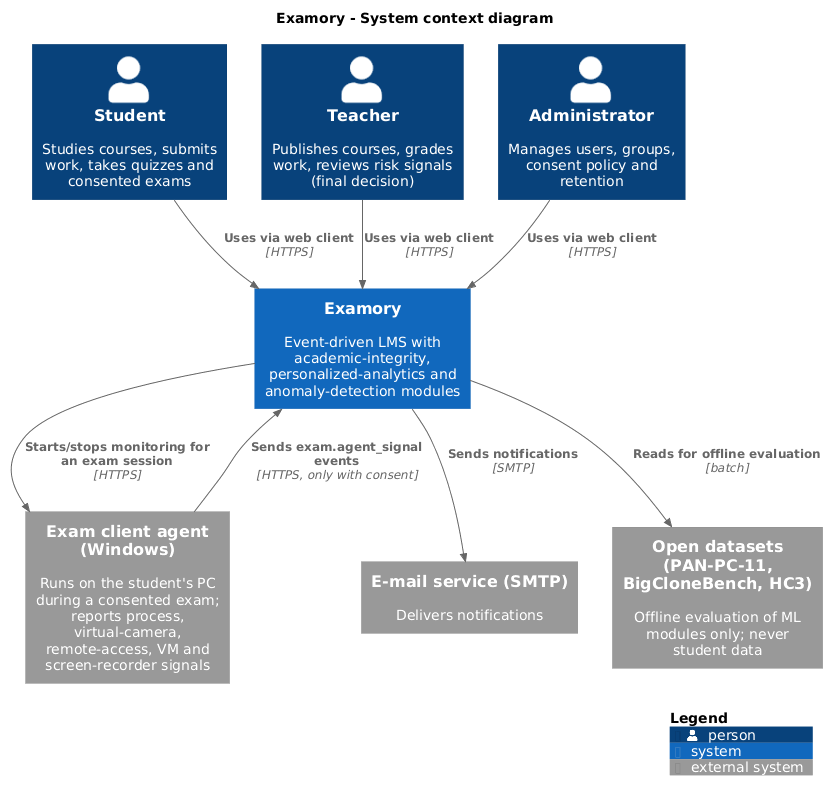
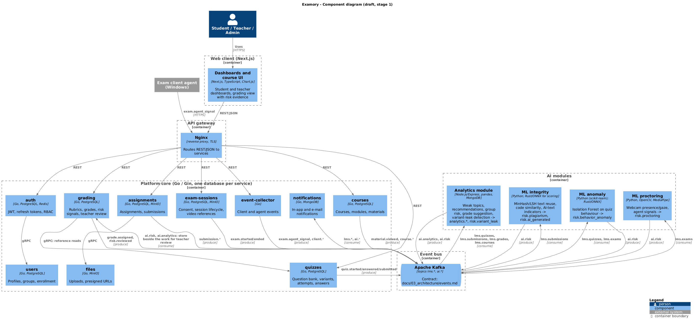

# Examory — System Architecture

Status: draft v0.1 (stage 1, October 2026). Owner: Kaiyrbekuly Aitbek.

## 1. Principles

1. **Event-driven.** Every meaningful learning action is published to Apache Kafka as an immutable event. Platform services write their own state to their own database and emit events; AI modules only consume events and publish risk signals back.
2. **Microservices with a single entry point.** Clients talk only to the API gateway (Nginx). Services communicate synchronously through REST/gRPC only when a request needs an immediate answer; everything else goes through Kafka.
3. **Human-in-the-loop.** No AI module changes a grade or blocks a student. AI modules produce `risk.*` events with a score and an explanation; the teacher sees them in the dashboard and makes the decision.
4. **Database per service.** No service reads another service's tables. Shared data is obtained through APIs or events.
5. **Privacy by design.** Video, webcam frames and exam-agent telemetry are collected only during an exam session, only with explicit student consent, and have a retention period.

## 2. Context

Editable diagrams: [context.puml](../04_uml/context.puml) (system context, C4) and [component.puml](../04_uml/component.puml) (component diagram, draft); PNG exports next to them. Technology decisions D1–D6 are justified in [technology_comparison.md](../07_analysis/technology_comparison.md).





```
Students, Teachers, Administrators
          │ HTTPS
          ▼
   ┌──────────────┐        ┌──────────────────────┐
   │ Next.js web  │        │ Exam client agent    │  (Windows, Go)
   └──────┬───────┘        └──────────┬───────────┘
          │                           │
          ▼                           ▼
   ┌──────────────────── Nginx API gateway ───────────────────┐
   │ auth │ users │ courses │ assignments │ quizzes │ grading  │
   │ notifications │ files │ exam-sessions │ analytics-api     │
   └───────────────────────────┬──────────────────────────────┘
                               │ events
                               ▼
                         Apache Kafka
                 ┌─────────────┼───────────────┐
                 ▼             ▼               ▼
         ML integrity    ML anomaly      Analytics module
         (Python)        (Python/Rust)   (Node.js + pandas)
                 └─────────────┴───────────────┘
                               │ risk.* / analytics.* events
                               ▼
                    grading / dashboards (teacher)
```

## 3. Services

### 3.1 Platform core (Go / Gin) — Kaiyrbekuly A.

| Service | Responsibility | Store | Publishes |
|---------|----------------|-------|-----------|
| `auth` | Registration, login, JWT access/refresh tokens (refresh in Redis), RBAC roles (student, teacher, admin, …) | PostgreSQL, Redis | `user.logged_in`, `user.logged_out` |
| `users` | Profiles, groups, enrollment of students into groups | PostgreSQL | `user.created`, `group.updated` |
| `courses` | Courses, modules, learning materials, enrollment of groups into courses | PostgreSQL | `course.*`, `material.viewed` |
| `assignments` | Assignments, submissions (text, files, code), deadlines, versions | PostgreSQL + MinIO | `assignment.published`, `submission.created`, `submission.updated` |
| `quizzes` | Question bank, test variants, attempts, per-question answers with timing | PostgreSQL | `quiz.started`, `quiz.answered`, `quiz.submitted` |
| `grading` | Rubrics, grades, weighted grade engine, teacher decisions on risk signals | PostgreSQL | `grade.assigned`, `risk.reviewed` |
| `notifications` | E-mail / in-app notifications, consumer of many topics | MongoDB | — |
| `files` | Upload/download through MinIO, presigned URLs, antivirus hook | MinIO | `file.uploaded` |
| `exam-sessions` | Exam session lifecycle, student consent, link between quiz attempt, webcam stream and client agent telemetry | PostgreSQL + MinIO (video) | `exam.started`, `exam.ended`, `exam.agent_signal` |
| `event-collector` | Thin HTTP/gRPC endpoint for the web client and the exam agent to push client-side events (focus lost, tab switched, paste) | — | `client.*` |

### 3.2 Exam session client agent (Go, Windows) — Kaiyrbekuly A.

Runs only during an exam session after the student's consent. Checks running processes, virtual cameras, remote-access tools, virtual machines and screen recorders through WMI and sends `exam.agent_signal` events. It never blocks anything on the student's machine; it only reports.

### 3.3 Personalized analytics module (Node.js / Express, Python) — Shadiyarbek S.

Consumes `quiz.*`, `submission.*`, `grade.*`, `material.viewed`. Aggregates per student and per group in MongoDB/PostgreSQL. Produces:

- weak topics and material recommendations for the student dashboard (`analytics.recommendation`);
- group performance and at-risk students for the teacher dashboard (`analytics.group_risk`);
- recommended grade by rubric criteria with explanation and a summary of the student's previous work (`analytics.grade_suggestion`);
- test-variant leak detection by abnormal growth of pass rate per variant (`risk.variant_leak`), with automatic replacement of the variant from the question bank through the `quizzes` API.

### 3.4 ML modules (Python, Rust) — Akhanov Y.

| Module | Input events | Method | Output |
|--------|--------------|--------|--------|
| Plagiarism (text and code) | `submission.created` | shingles / MinHash, sentence embeddings, token-based code similarity | `risk.plagiarism` with matched submissions and similarity score |
| AI-generated text indicators | `submission.created` | perplexity / stylometric features, classifier | `risk.ai_generated` (signal only) |
| Behavioral anomalies in quizzes | `quiz.answered`, `quiz.submitted`, `client.*` | Isolation Forest, autoencoders on answer timing, answer patterns, score jumps, synchronous submissions | `risk.behavior_anomaly` |
| Proctoring | webcam frames from `exam-sessions`, `exam.agent_signal` | OpenCV, MediaPipe (presence, gaze), virtual camera / deepfake indicators | `risk.proctoring` |
| Inference service | — | ONNX Runtime served by Rust (Axum) for low-latency scoring | HTTP API used by the modules above |

Each module is evaluated on synthetic and open datasets with precision, recall and false-positive rate before integration.

## 4. Data flow example: assignment submission

1. Student uploads a file in the web client → `files` stores it in MinIO → `file.uploaded`.
2. Student submits → `assignments` saves the submission → `submission.created` (with file reference and extracted text).
3. ML integrity consumes the event, compares with the corpus, publishes `risk.plagiarism` (score, matched submission IDs, explanation).
4. Analytics consumes the event, updates student progress, publishes `analytics.grade_suggestion` when the teacher opens grading.
5. `grading` stores risk signals next to the submission; the teacher sees them, decides, and `risk.reviewed` is published with the decision (confirmed / dismissed). Reviewed decisions become labelled data for evaluating false positives.

## 5. Infrastructure

- Docker Compose for local development (`docker-compose.yml` in repository root), one container per service.
- Nginx as API gateway and TLS termination.
- GitHub Actions: build and test on every pull request; image build on tags.
- Production target: a single VPS with Docker Compose for the MVP; Kubernetes is out of scope.

## 6. Open questions

- ~~gRPC vs REST for service-to-service calls~~ — decided: REST/JSON at the gateway, gRPC between core services (technology_comparison.md, D4).
- Schema registry for Kafka events (JSON Schema in repository vs Confluent Schema Registry).
- Where exactly extracted text of submissions is stored (inside the event vs MinIO reference).
- Retention period for exam video recordings and agent telemetry (legal review).
