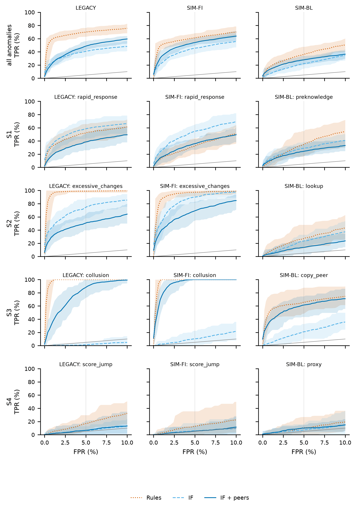
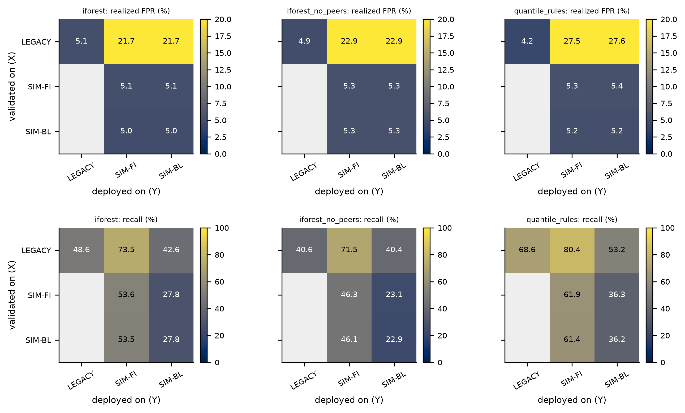
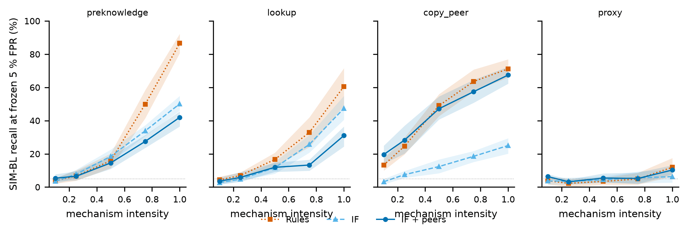
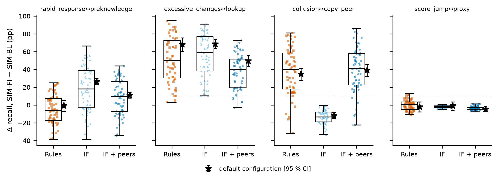
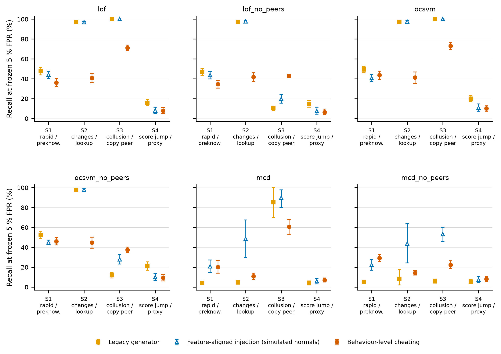
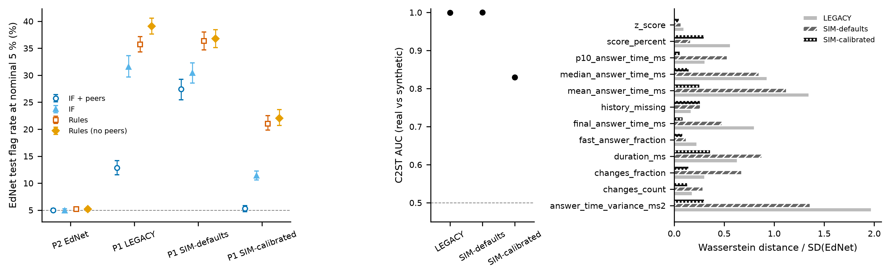

# Feature injection can inflate the performance of quiz-cheating detectors: evidence from behaviour-level simulation

**Status:** complete draft, 14 Nov 2026; numbers are copied from the generated tables and were cross-checked against them.

**Authors:** Aitbek Kaiyrbekuly¹, [co-authors to be confirmed], Aivar A. Sakhipov¹
¹ School of Software Engineering, Astana IT University, Astana, Kazakhstan

**Abstract.** Detectors of cheating in online quizzes are usually evaluated without verified labels, and a common substitute is to inject synthetic anomalies into ordinary attempts. When the injected anomaly is defined in terms of the detector's own features, the evaluation becomes circular; we measure how large this effect is. Three detectors frozen in advance (per-feature quantile rules, an Isolation Forest, and the forest with peer features) are evaluated on a feature-aligned generator, on a behaviour-level simulation and on real unlabelled logs. In the simulation, honest students follow an item-response and response-time model calibrated on EdNet, and cheating is simulated as behaviour (pre-knowledge, answer look-up, peer copying, proxy test-taking); paired counterfactual worlds render the same students and the same cheaters once with feature-aligned injection and once with behaviour-level cheating. At a fixed 5 % false-positive rate, overall recall falls from 46–62 % under injection to 23–36 % under behaviour-level cheating. The loss depends on the cheating type: 54–70 percentage points for look-up with all three detectors, 34–39 points for peer copying with the two peer-aware detectors, 11–26 points for pre-knowledge with the forests and none with the rules, while proxy test-taking is detected near chance in every condition. The large losses persist across wide variation of the assumed mechanism parameters, but their size, and for pre-knowledge even their sign, depends on how intensively students cheat, and detection of copying by peer-aware detectors depends largely on whether a pair submits simultaneously. Detectors without peer features that were fitted on synthetic ordinary behaviour flag 11–39 % of real attempts at a nominal 5 %, and on real data false alerts concentrate on the fastest students and on both ends of the score distribution. The multivariate detector does not outperform transparent rules. We give recommendations for evaluating log-based cheating detectors and release the simulator, calibration and all results.

**Keywords:** academic integrity; online assessment; anomaly detection; cheating detection; synthetic data; evaluation methodology; response times; learning analytics

---

## 1. Introduction

Online quizzes and examinations leave a detailed trace of how a student worked: when each question was shown, how long the first answer took, whether it was later changed, and when the attempt was submitted. Unsupervised and remote assessment makes misconduct easier, and a substantial share of students report having cheated in online exams [@newton2024howcommon]. A growing body of work therefore proposes to mine these traces for signs of cheating with statistical rules or anomaly detectors [@chandola2009survey; @noorbehbahani2022review; @kaddoura2022review; @trezise2019misconduct; @balderas2020records]. Such detectors are attractive for learning management systems: they need no camera, no lockdown browser and no additional consent beyond what the platform already logs.

The weak point of this line of work is evaluation. Verified labels of cheating are almost never available: confirmed cases are rare, confidential, and biased towards what existing procedures already catch. Some studies induce cheating in field experiments under controlled conditions [@ranger2020eexams]. Others derive labels from dedicated algorithms on real platform data [@northcutt2016cameo; @ruiperez2019multiple; @alexandron2024general]. Both kinds of study are costly and remain exceptions. As Alexandron et al. note, in the absence of ground truth most earlier research on cheating detection relied on simulations or indirect measures [@alexandron2024general].

A common shortcut is therefore to generate the positive class synthetically. Ordinary attempts are produced from some distribution, and "cheating" attempts are produced by perturbing them: answers become faster, the score jumps, two students receive the same answers at the same time. Kamalov et al., for example, evaluate an outlier detector for exam scores on synthetic datasets in which cheating is defined as a jump of the final score above the student's earlier average, the same quantity the detector examines [@kamalov2021cheating]. A recent Moodle plug-in is likewise evaluated on synthetic benchmarks representing forms of dishonesty [@shatnawi2025moodle].

We call this practice **feature-aligned injection**: the anomaly is defined directly in terms of the quantities that the detector measures. Its danger is circularity. If "rapid responding" is injected by shortening response times, a detector that thresholds response times will find it. The reported recall then describes the agreement between the generator and the detector, not the ability to find students who actually cheated.

Real misconduct is a behaviour with a mechanism: copying from a peer, looking an answer up, knowing leaked items in advance, letting someone else sit the test. Its footprint in the log is a by-product of that mechanism. The footprint may be weak, may be spread across several features, and may depend on the ability of the student (a strong student who copies changes little). It may even have the opposite sign to the one assumed by the injection: looking an answer up makes a student slower, not faster.

Related fields have documented the same problem under other names:
- benchmark construction determines what outlier detectors appear to achieve [@emmott2013benchmarks; @campos2016evaluation; @steinbuss2021benchmarking];
- laboratory-only evaluation and inappropriate threat models inflate results in security [@arp2022dos];
- leakage between the construction of the data and the model is a recurring cause of irreproducible machine-learning claims [@kapoor2023leakage; @hand2006illusion].

For log-based cheating detection the size of this effect has not been measured. This paper measures it. We take three detectors that were designed and frozen before the experiment:
- per-feature quantile rules;
- an Isolation Forest [@liu2008isolation] on attempt-level features;
- the same forest extended with peer features (synchronous submission and answer agreement).

We then evaluate the identical code three times:

1. on a **feature-aligned generator**, in which four anomaly types are injected along the detector's own features;
2. on a **behaviour-level simulation**. Honest students follow a latent learner model (ability, speed, disengagement and revision propensity), with item response theory for correctness and a lognormal model for response times [@vanderlinden2006lognormal; @vanderlinden2007hierarchical], calibrated on real interaction logs. Cheating is simulated as actions: pre-knowledge of leaked items, answer look-up, copying from a peer with a communication delay, and a proxy test-taker. Features are computed afterwards by the unchanged production pipeline;
3. on **real logs** from the EdNet dataset [@choi2020ednet]. These contain no cheating labels and are used to estimate how often ordinary behaviour is flagged.

The simulation is built as a set of *paired counterfactual worlds*. The same simulated students, the same honest attempts and the same set of cheaters are rendered once with feature-aligned injection and once with behaviour-level cheating. The difference in detector performance between the two worlds is therefore attributable to the way the anomalies are produced and to nothing else.

**Contributions.**

- We define feature-aligned injection as an evaluation pitfall for log-based cheating detectors. We separate two sources of optimism: unrealistic ordinary behaviour, and anomalies aligned with detector features.
- We provide an open behaviour-level simulator of quiz attempts with four cheating mechanisms. It is calibrated on public data and emits events in the same contract as a production LMS. With it comes the paired-world design that isolates the effect of the injection mechanism.
- For three frozen detectors, plus three additional unsupervised detectors as a robustness check, we quantify the difference in recall and partial AUC at a fixed false-positive budget and report precision. This includes transfer of thresholds between evaluation regimes, dose–response curves over cheating intensity, and a sensitivity analysis over the assumed mechanism parameters.
- We report the flag rate of the same detectors on real unlabelled behaviour and show which ordinary students are flagged.
- All code, parameters, seeds and result files are released so that every table and figure can be regenerated.

The detectors studied here produce risk signals for review by a teacher. None of the results should be read as evidence that statistical flags can establish misconduct.

## 2. Related work

### 2.1 Cheating in online assessment and its detection from logs

Newton and Essex synthesise self-report surveys and find that 44.7 % of students admitted to cheating in online exams: 29.9 % before and 54.7 % during the COVID-19 pandemic. Individual cheating was more common than group cheating, and most samples make under-reporting likely [@newton2024howcommon]. Comparisons of proctored and unproctored online tests point in the same direction: scores are higher and time use differs when tests are unproctored [@alessio2017proctoring; @dendir2020proctoring; @bilen2021online]. Reviews of the field describe a wide range of prevention and detection approaches, from proctoring to analysis of answers and activity logs [@noorbehbahani2022review; @kaddoura2022review; @holden2021integrity].

Log-based detection in learning platforms has mostly been validated where labels could be derived from the platform itself. In MOOCs, "multiple-account" copying means harvesting correct answers with one account and submitting them with another. It leaves a characteristic signature that dedicated algorithms can label [@northcutt2016cameo; @alexandron2017copying; @ruiperez2019multiple]. Alexandron et al. use such labels to validate a general anomaly-based method across cheating types and courses [@alexandron2024general]. Case studies in university courses analyse learning records and writing behaviour around specific assessments [@balderas2020records; @trezise2019misconduct]. Where neither labels nor experiments are available, evaluation falls back on synthetic positives [@kamalov2021cheating; @shatnawi2025moodle].

### 2.2 Psychometric detection of test fraud

Educational measurement has a long tradition of statistical indices for specific forms of fraud:
- answer-copying statistics that compare the agreement of two examinees with what their abilities predict [@wollack1997copying; @sotaridona2002kindex];
- response-time models that flag responses faster than expected for an item and a person [@vanderlinden2003aberrant; @vanderlinden2008bayesian; @vanderlinden2015checks];
- methods for item pre-knowledge based on scores, response times or both [@qian2016preknowledge; @sinharay2017preknowledge; @sinharay2020rt; @zimmermann2016local; @eckerly2017preknowledge].

The handbook edited by Cizek and Wollack surveys these methods and stresses that their power depends on how much of the test is affected and on how the fraud is carried out [@cizek2017handbook]. Machine-learning approaches have been applied to the same problem on real credentialing data with flagged examinees [@man2019datamining; @zopluoglu2019xgboost].

The study closest to ours in spirit is the field experiment of Ranger, Schmidt and Wolgast [@ranger2020eexams]. They induced cheating in a 20-item computer-based mock exam: some students received notes with answers, and others practised on items that later appeared in the exam. According to that paper, at a 5 % false-positive rate response-time indicators detected roughly 40–60 % of students with pre-knowledge, and none of the indicators detected the milder form of collusion. A classification tree over 18 indicators reached a sensitivity of 0.42. These figures come from behaviourally induced cheating and are well below the detection rates reported on injected anomalies; Kamalov et al. report, for example, a true-positive rate of about 95 % on synthetic score jumps [@kamalov2021cheating]. The gap motivates a systematic comparison of the two ways of constructing positives.

This literature also supplies the building blocks of our simulator:
- the hierarchical model of speed and accuracy [@vanderlinden2007hierarchical];
- the lognormal model of response times [@vanderlinden2006lognormal];
- rapid-guessing behaviour of disengaged but honest examinees [@wise2005rte; @wise2017rapid];
- the empirical regularities of answer changing, in which most changes go from wrong to right [@benjamin1984staying; @vanderlinden2012changes].

### 2.3 Evaluation of anomaly detectors on synthetic data

How anomalies are constructed is known to drive benchmark conclusions in unsupervised outlier detection:
- Emmott et al. construct benchmarks from real data while controlling point difficulty, relative frequency, clusteredness and feature irrelevance. They show that these properties, not the algorithm alone, determine measured performance [@emmott2013benchmarks].
- Campos et al. and Goldstein and Uchida document the sensitivity of rankings to datasets and measures [@campos2016evaluation; @goldstein2016comparative].
- Steinbuss and Böhm propose to reconstruct regular instances from real data and to generate outliers with explicit characteristics [@steinbuss2021benchmarking].
- ADBench compares detectors across types of synthetic anomalies and finds that no method dominates across them [@han2022adbench].

Methodological work in neighbouring areas reaches similar conclusions. It lists laboratory-only evaluation and threat models that do not match deployment among the common pitfalls [@arp2022dos], and identifies leakage between data construction and modelling as a cause of over-optimistic results [@kapoor2023leakage]. Hand argues that apparent progress in classifier technology often reflects the idealised conditions of the evaluation rather than performance on the real problem; the argument applies directly [@hand2006illusion].

What is missing is a measurement for cheating detection in assessment logs. Here the anomalies of interest are intentional behaviours with known mechanisms, and false positives carry a high cost for the individual student. Our study fills this gap by holding fixed the detectors, the cohort structure, the honest population and the set of cheaters, and varying only how the cheating attempts are produced.

## 3. Materials and methods

### 3.1 Overview of the design

The experiment holds the detectors fixed and varies the evaluation data. Three **conditions** are compared:

| Condition | Ordinary behaviour | How cheating attempts are produced |
|---|---|---|
| LEGACY | ad hoc distributions of the original generator | feature-aligned injection |
| SIM-FI | latent learner model calibrated on EdNet | feature-aligned injection (same recipes) |
| SIM-BL | latent learner model calibrated on EdNet | behaviour-level mechanisms |

SIM-FI and SIM-BL are two renderings of the *same simulated world*: the same students, items, honest attempts, cohort structure and set of cheaters. Two contrasts follow:
- SIM-FI − SIM-BL isolates the effect of the injection mechanism;
- LEGACY − SIM-FI reflects the realism of ordinary behaviour.

A fourth data source, real EdNet logs without labels, is used to measure flag rates on ordinary behaviour and to quantify how far each synthetic source is from real data.

All conditions share the assessment format of the original generator:
- cohorts of 20 students;
- a 20-item four-option multiple-choice quiz;
- three attempts per student on consecutive days;
- cheating only on the final attempt.

In the main experiment 12 % of all attempts (36 % of final attempts) are cheating attempts, split 35/25/25/15 % over four types. A separate analysis uses a prevalence of 5 % of final attempts. Each replicate has 2,000 students (100 cohorts, 6,000 attempts). Twenty independent replicates (seeds 1001–1020) are generated per condition for the main, transfer, robustness and prevalence analyses; Section 3.6 lists the replicate count of every other analysis.

### 3.2 Detectors (frozen)

The detectors are those of the Examory platform as tagged at its first project milestone (tag `pre-defense-1`, 23 Oct 2026), before the behaviour-level simulator existed. The code under `ml/anomaly/` was not modified for this study, and its file hashes are recorded with every result.

Each quiz attempt is described by twelve attempt-level features computed from `quiz.answered` and `quiz.submitted` events:
- mean, median, 10th percentile and variance of first-answer times;
- the fraction of answers faster than the item's 10th-percentile time among ordinary training attempts (items with fewer than 30 training observations use the global 10th percentile);
- the time since display of the final answer to the last-answered question;
- attempt duration;
- number and fraction of answer changes;
- percentage score;
- the standardised difference between the score and the student's earlier attempts;
- an indicator of missing history.

Three **peer features** are computed against other students of the same cohort, quiz and variant who submitted within ±5 s:
- the number of such synchronous submissions;
- the maximum fraction of identical final answers;
- the same agreement weighted by the rarity of the shared answers.

Time, count and rarity features are log-transformed. Every feature has a missing-value indicator, so the forest without peer features sees 24 columns and the other two detectors see 30.

Three detectors are evaluated:

- **Rules** (`quantile_rules`): the score of an attempt is its most extreme two-sided mid-rank over all features with respect to ordinary training attempts;
- **IF** (`iforest_no_peers`): an Isolation Forest [@liu2008isolation] with 200 trees on the twelve attempt-level features;
- **IF + peers** (`iforest`): the same forest on all fifteen features.

Both forests use the scikit-learn implementation [@pedregosa2011sklearn].

The protocol is as follows:
- Cohorts are split 60/20/20 into training, validation and test sets, so that no student or cohort appears in two parts.
- References and models are fitted on ordinary attempts of the training cohorts.
- The alert threshold is chosen on the validation cohorts as the point of maximum recall subject to a false-positive rate (FPR) of at most 5 % (and, separately, 1 %), and is then frozen. The threshold choice uses the validation labels of the same condition, so it is an oracle operating point for that condition.
- All reported metrics are computed on the test cohorts.

As a robustness check, three further unsupervised detectors are run under the identical protocol on the same feature matrix, standardised and with constant columns removed: the local outlier factor [@breunig2000lof], a one-class support vector machine [@scholkopf2001support] and a robust Mahalanobis distance (minimum covariance determinant), all from scikit-learn.

### 3.3 Feature-aligned injection

The original generator draws ordinary attempts from three response-time profiles (lognormal, medians 18–38 s), a Beta-distributed probability of a correct answer and a per-profile probability of changing an answer. Four anomaly types are then injected on final attempts, each along one family of detector features:

- **rapid response:** each answer is, with probability 0.65, made faster by a factor drawn from U(0.18, 0.55);
- **excessive changes:** each question receives, with a probability drawn from U(0.45, 0.75), a sequence of one to four answer changes that replaces its own revisions. The events are spread evenly over the original first-answer time, so the first answer moves earlier and first-answer times also shorten;
- **collusion:** two students of a cohort receive a common answer pattern (30 % of items forced to the same wrong option, the rest copied with probability 0.90), response times identical up to ±3 %, start times within 8 s and submissions within 1 s of each other;
- **score jump:** the probability of a correct answer is raised by U(0.18, 0.32).

In SIM-FI the same four recipes, with the same constants, are applied to the honest attempts of the simulated students. The port differs from the original in four details:
- the forced collusion option is the item's least attractive distractor;
- collusion durations are the leader's honest item times;
- the score jump shifts the item-response probability of a correct first answer (capped at 0.98) and keeps the number of changes and all timings at their honest values;
- rapid response scales every event time within an affected item.

### 3.4 Behaviour-level simulation

**Honest behaviour.** A student *i* has ability θ_i ~ N(0, 1), speed τ_i (correlated with ability), a disengagement propensity g_i and a revision propensity r_i. Ability changes by a person-specific practice gain between attempts. An item *j* has discrimination a_j, difficulty b_j, a common pseudo-guessing parameter c, time intensity β_j, time dispersion σ_j and unequally attractive distractors. A response is generated as follows:
- With probability g_i it is a rapid guess: a short lognormal time and a uniformly random option [@wise2005rte; @wise2017rapid].
- Otherwise the student knows the answer with probability logistic(a_j(θ_i − b_j)) and, if not, guesses correctly with probability c, which yields the three-parameter logistic model. A wrong answer is drawn according to the distractor weights.
- The response time follows the lognormal model log T_ij = β_j − τ_i + σ_j ε [@vanderlinden2006lognormal; @vanderlinden2007hierarchical].
- After the first answer the student may change it. The probability is higher after a wrong first answer, and a change from a wrong answer leads to the correct one with a calibrated probability [@benjamin1984staying; @vanderlinden2012changes].
- Navigation is linear, with a lognormal gap between items and a final pause before submission.

**Calibration.** All parameters of the honest model are estimated from EdNet-KT2 [@choi2020ednet], the action-level log of a TOEIC tutoring service, restricted to Part 5 (four-option, single-question items without audio). Users are split by a hash of their identifier into a calibration half and an evaluation half; only the calibration half is used here. The estimates are obtained as follows:
- **Item and person parameters:** joint maximum-a-posteriori estimation of the three-parameter model on non-rapid first answers, with a parametric-bootstrap correction of the incidental-parameter bias. The common *c* = 0.125 was selected by profile posterior, but that fit had not converged at the iteration limit, and a parametric replicate selected *c* = 0.10.
- **Response-time parameters:** a two-way lognormal fit.
- **Rapid guessing:** the normative threshold of 10 % of an item's mean time, capped at 10 s.
- **Person-level propensities:** beta-binomial maximum likelihood, which separates between-person variation from sampling noise.
- **Practice gain:** weakly identified (mean 0.07, 95 % CI [−0.01, 0.17]; 600 pairs of consecutive windows).

Items with discrimination below 0.25 or |b| > 4, whose difficulty is not identified, are excluded from the simulator's item pool (91 of 1,180). The calibration report states that this rule was fixed before any detector was run on calibrated data.

Table S1 lists the estimates with confidence intervals and posterior-predictive diagnostics on held-out calibration users. The model reproduces pooled first-answer times well, but it remains:
- too dispersed within attempts;
- too narrow in attempt duration;
- about one point too low in score;
- too light in the tail of the change count.

Section 4.9 reports how closely simulated attempts reproduce real attempts of the evaluation half.

**Cheating mechanisms.** Cheating is simulated as actions on top of the honest attempt of the same student. The mechanism re-uses the student's latent draws (common random numbers), so an attempt changes only where the mechanism acts. Mechanism parameters are not available from data. They are set to documented priors (Table S2, Appendix) and varied in the sensitivity analysis (Section 3.6).

- **Pre-knowledge** (paired with *rapid response*). Each item is leaked with probability 0.65, and a leaked item is recalled with probability 0.92, in which case the answer is correct. Each cheater is *naive* with probability 0.5 and answers recalled items in a fraction U(0.25, 0.60) of their ordinary time. The others *disguise* their timing and answer at their ordinary pace.
- **Look-up** (paired with *excessive changes*). On an item that the student does not know and does not rapid-guess, an external resource is consulted with probability 0.70. The look-up takes a lognormal time (median 35 s) and returns the correct answer with probability 0.90. Half of the cheaters, in expectation, enter their own answer first and correct it after the look-up (a change event if the answers differ). The others answer only after the look-up.
- **Peer copying** (paired with *collusion*). Two students of a cohort form a pair, and the abler one is the source with probability 0.80. The protocol is:
  - the copier starts shortly after the source (median lag 15 s) and copies each item with probability 0.80;
  - the copied answer becomes available only after the source has answered that item plus a relay delay (median 6 s), so the copier waits when ahead and answers quickly when behind;
  - the source answers honestly but pauses for a communication overhead (median 3 s) after each item the copier copies;
  - later changes by the source are followed with probability 0.50;
  - with probability 0.50 the pair submits together: the earlier finisher delays submission to within a lognormal offset (median about 2 s) of the later one. Under this distribution about one synchronised pair in ten still differs by more than 5 s. Otherwise each submits when finished.
- **Proxy test-taker** (paired with *score jump*). The final attempt is taken by a different, abler person. That person's ability is drawn from N(1.2, 0.5²), truncated to at least 0.5 above the student's own, with speed drawn conditional on that ability, a fresh revision propensity, and no rapid guessing.

The pairing of mechanisms with injected types follows what each injected type is commonly meant to represent, and cheaters keep the same type slot in SIM-FI and SIM-BL. Synchronised submission was added to peer copying after a single-seed pilot on uncalibrated parameters. In that pilot only 9 of 90 pairs submitted within the 5 s window of the peer features, so the features were almost never evaluated. The amendment makes peer copying *easier* to detect. Its share of 50 % is an assumption, and pooled peer-copying results depend on it; we therefore report both kinds of pairs separately (Sections 4.3 and 4.5).

**Implementation.** The simulator is a dependency-free Go program. Every random quantity is drawn from its own stream keyed by a hash of the seed and of the entity it belongs to. As a result, attempts not touched by cheating are byte-identical in the honest, SIM-FI and SIM-BL logs. The simulator writes events in the platform's event contract, and the unchanged production feature pipeline computes all features. A per-attempt ground-truth file records the latent variables, the mechanism, the role in a pair and the affected items.

### 3.5 Real data

The evaluation half of EdNet-KT2 is converted into the same event contract. A *pseudo-attempt* is a run of 20 consecutive Part-5 questions answered in one sitting (every gap at most 5 min), with at most five pseudo-attempts per user. Repeated exposures to a question, review sessions and re-solved bookmarked questions are excluded. This yields 23,042 attempts of 10,671 users, grouped into 534 pseudo-cohorts of 20 users.

These users are the 7.2 % of evaluation users with Part-5 activity (10,671 of 147,756) who produced at least one such sitting, so they are the more persistent learners. First-answer times, answer changes and scores are real. Cohorts are artificial, so peer features carry no meaning on these data and are reported only for completeness. The service is an ungraded self-study tutor; we assume that cheating is negligible there and interpret the share of flagged attempts as a false-positive rate.

Two protocols are used:
- **Transfer.** A detector and its threshold are fitted on synthetic ordinary attempts and applied unchanged to real attempts. The synthetic source is either LEGACY or the honest simulator world, with item sets drawn per attempt as in EdNet. The LEGACY threshold is chosen with LEGACY validation labels, as in the main protocol. The simulator threshold is chosen on honest validation attempts only, at 5 % of them.
- **Refit.** The detector is fitted and its threshold set on real training and validation cohorts, and the flag rate on real test cohorts is broken down by strata of ordinary students.

Because the frozen rules include peer features, a peer-free variant is added for the real data: the frozen quantile-rule scoring function applied to the twelve attempt-level features. This variant was built by the evaluation harness and is not part of the frozen pipeline.

Realism of the synthetic sources is quantified by a classifier two-sample test [@lopezpaz2017c2st]. A gradient-boosting classifier (scikit-learn) is trained to distinguish real from synthetic ordinary attempts on the behavioural features, with cross-validation grouped by user. An area under the ROC curve (AUC) of 0.5 means the two are indistinguishable. Per-feature Kolmogorov–Smirnov statistics and standardised Wasserstein distances complement it.

### 3.6 Analysis plan

The plan is stored with the code (`ml/experiments/inflation/README.md`). The primary endpoint, tests, corrections and the H1 rule were fixed before the multi-seed runs. Secondary analyses were added after the uncalibrated run and before the calibrated rerun: the manipulation check, the non-sync subset, the C2ST feature set and the strata. The amendment log is in the same README. The repository history does not independently date these steps, because plan, simulator, calibration and results were committed together.

**Metrics.** For every detector, condition and replicate we compute:
- recall, precision and realised FPR at the validation-frozen 5 % threshold;
- the standardised partial AUC for FPR ≤ 0.05 [@mcclish1989partial];
- ROC AUC and average precision.

Metrics are reported for all test attempts and for each cheating type against all ordinary test attempts.

**Inflation.** The primary outcome is the difference in recall at the frozen 5 % threshold between SIM-FI and SIM-BL, per detector and type. Replicates are paired by seed; we report the mean difference with a paired bootstrap 95 % confidence interval and a Wilcoxon signed-rank test [@wilcoxon1945individual; @efron1993bootstrap]. LEGACY − SIM-BL is reported with unpaired tests. *p*-values are adjusted by the Holm procedure within each family of twelve detector-by-type tests [@holm1979simple].

**Hypothesis H1.** The platform's verification plan states that the forest with peer features should exceed the rules in recall by at least 15 percentage points at FPR ≤ 5 % on collusion-type and score-jump-type cheating. If the gain is below 5 points, the rules are adopted. The plan names two data sources: the detector-independent simulated evaluation set and real anonymised quiz logs. Here the hypothesis is tested on SIM-BL, with Holm adjustment over the two types.

**Secondary analyses.**
- (i) *Transfer between conditions:* a detector validated on one condition is applied to the test cohorts of another (20 replicates).
- (ii) *Dose–response:* SIM-BL is regenerated with the intensity of every mechanism set to 0.1, 0.25, 0.5, 0.75 and 1.0 (10 replicates, seeds 1001–1010). For pre-knowledge, look-up and peer copying the intensity replaces the per-item coverage or propensity. For the proxy it scales the ability gain. The share of synchronously submitting pairs is not changed.
- (iii) *Sensitivity:* forty configurations of ten mechanism parameters are drawn by Latin hypercube sampling over wide ranges (Table S2), three replicates each (seeds 1001–1003), and the inflation is recomputed for each. Spearman correlations between parameters and inflation are exploratory and uncorrected.
- (iv) *Prevalence:* the main protocol at 5 % of final attempts (20 replicates).
- (v) *Manipulation check:* paired differences between each cheating attempt and the same student's honest attempt in score, duration, answer changes and median answer time.
- (vi) *Real data:* 10 replicates (seeds 1001–1010), which vary the cohort split and the synthetic training data.

**Reproducibility.** Simulation, calibration and analysis are deterministic given the seeds. Simulator output is byte-identical on the same platform; floating-point rounding can differ across CPU architectures. Every result file records:
- the code revision;
- the hashes of the frozen detector code, of the harness, of all parameter files and of the input data;
- the library versions.

## 4. Results

All tables in this section are copied from the generated files in `ml/experiments/inflation/results/tables/`. Values are means over replicates with 95 % bootstrap confidence intervals over replicates. The replicate count is 20 for Sections 4.1–4.4 and 4.6–4.8, 10 for dose–response and real data, and 3 per configuration for the sensitivity analysis. Simulator parameters are the EdNet-calibrated ones. The same experiment with uncalibrated default parameters is summarised at the end of Section 4.2 and listed in full in the supplementary material.

### 4.1 What the manipulations change

Table 1 compares each cheating attempt with the honest attempt of the same simulated student.

The four injected types differ in how many quantities they move:
- *Rapid response* removes about 200 s of working time without changing the score.
- *Score jump* adds about three points and leaves timing and changes untouched.
- *Excessive changes* adds about 27 answer-change events to a 20-item attempt. Because the injected events are spread over the original answer time, it also shortens the median first-answer time by about 10 s, as much as rapid response does.
- *Collusion* lowers the score by 3.6 points and removes about four changes.

The behaviour-level mechanisms move several quantities moderately, and not always in the direction the corresponding injection assumes. Looking answers up raises the score by 4.5 points but makes the attempt 262 s *longer* and adds less than one change event. Peer copying changes the average score by only 0.6 points. This average covers sources, whose answers are unchanged, and copiers, whose gain depends on the ability difference within the pair.

**Table 1.** Manipulation check: mean difference between a cheating attempt and the same student's honest attempt.

| World | Type | Δ score (points of 20) | Δ duration (s) | Δ answer changes | Δ median first-answer time (s) |
|---|---|---:|---:|---:|---:|
| SIM-FI | rapid response | 0.00 | −199.8 | 0.00 | −9.80 |
| SIM-FI | excessive changes | 0.00 | −14.6 | +27.35 | −9.98 |
| SIM-FI | collusion | −3.63 | +18.0 | −4.33 | +0.91 |
| SIM-FI | score jump | +2.91 | 0.0 | 0.00 | 0.00 |
| SIM-BL | pre-knowledge | +4.86 | −92.7 | −2.68 | −4.00 |
| SIM-BL | look-up | +4.46 | +262.4 | +0.61 | +4.50 |
| SIM-BL | peer copying | +0.56 | +64.6 | −1.31 | −1.42 |
| SIM-BL | proxy | +2.91 | −54.5 | −0.89 | −2.14 |

### 4.2 Detector performance under the three conditions

The realised false-positive rate over all test attempts is close to the nominal 5 % in every condition (4.2–5.3 %), so differences in recall are not an artefact of different operating points. Recall is given in Table 2 and Figure 1. Figure 2 shows the ROC curves for FPR ≤ 10 %.

**Figure 1.** Recall at the validation-frozen 5 % FPR threshold by cheating type, detector and condition (mean over 20 replicates with 95 % bootstrap interval).

**Figure 2.** ROC curves restricted to FPR ≤ 10 % for all cheating attempts and for each type, by condition and detector (mean over replicates with 2.5–97.5 % band; grey line: chance).

**Table 2.** Recall (%) at the validation-frozen 5 % FPR threshold.

| Detector | Cheating type (injected ↔ behavioural) | LEGACY | SIM-FI | SIM-BL |
|---|---|---:|---:|---:|
| Rules | all | 68.6 [66.8, 70.4] | 61.9 [59.8, 64.0] | 36.2 [33.0, 39.3] |
| Rules | rapid response ↔ pre-knowledge | 49.7 [46.1, 53.2] | 34.1 [29.9, 38.2] | 34.3 [29.9, 38.6] |
| Rules | excessive changes ↔ look-up | 99.0 [98.5, 99.6] | 97.8 [96.7, 98.8] | 28.0 [23.1, 33.0] |
| Rules | collusion ↔ peer copying | 100.0 [100.0, 100.0] | 100.0 [100.0, 100.0] | 65.5 [60.1, 70.9] |
| Rules | score jump ↔ proxy | 14.0 [10.5, 17.6] | 12.3 [8.2, 17.4] | 10.7 [7.3, 14.2] |
| IF | all | 40.6 [38.2, 42.9] | 46.3 [43.9, 48.5] | 22.9 [21.0, 24.9] |
| IF | rapid response ↔ pre-knowledge | 57.9 [54.0, 61.8] | 55.6 [52.5, 58.5] | 29.8 [27.4, 32.3] |
| IF | excessive changes ↔ look-up | 74.1 [70.7, 77.4] | 91.1 [88.9, 93.2] | 23.2 [20.7, 26.0] |
| IF | collusion ↔ peer copying | 1.4 [0.5, 2.4] | 11.0 [7.7, 14.5] | 21.5 [18.7, 24.3] |
| IF | score jump ↔ proxy | 6.3 [4.4, 8.3] | 5.6 [3.6, 8.1] | 8.3 [5.8, 11.1] |
| IF + peers | all | 48.6 [46.7, 50.5] | 53.6 [51.9, 55.3] | 27.8 [25.8, 29.7] |
| IF + peers | rapid response ↔ pre-knowledge | 38.6 [35.0, 42.1] | 35.4 [32.5, 38.4] | 24.2 [22.1, 26.4] |
| IF + peers | excessive changes ↔ look-up | 50.0 [46.6, 53.4] | 68.0 [63.5, 72.4] | 14.4 [11.7, 17.2] |
| IF + peers | collusion ↔ peer copying | 88.8 [84.9, 92.5] | 100.0 [100.0, 100.0] | 61.0 [56.5, 65.4] |
| IF + peers | score jump ↔ proxy | 6.6 [4.1, 9.1] | 5.1 [3.1, 7.2] | 9.5 [7.8, 11.3] |

SIM-BL recall on peer copying pools pairs that submit together and pairs that do not, so it depends on the assumed 50 % share of synchronously submitting pairs (Section 4.3).

Over all cheating attempts, recall under behaviour-level cheating is between 0.49 and 0.58 of what the same detector achieves under feature-aligned injection on the same simulated students:
- rules: 36.2 % against 61.9 %;
- forest: 22.9 % against 46.3 %;
- forest with peer features: 27.8 % against 53.6 %.

The standardised partial AUC for FPR ≤ 0.05 shows the same pattern independently of the threshold (0.5 is chance): 0.758 → 0.616 for the rules, 0.656 → 0.555 for the forest and 0.700 → 0.589 for the forest with peer features.

**Table 3.** Difference in recall at the frozen 5 % threshold, SIM-FI − SIM-BL, in percentage points, paired by replicate (n = 20; Wilcoxon signed-rank; Holm-adjusted over the twelve tests).

| Detector | Cheating type | Δ recall, pp [95 % CI] | p (Holm) |
|---|---|---:|---:|
| Rules | rapid response ↔ pre-knowledge | −0.2 [−6.1, 5.3] | 1.000 |
| Rules | excessive changes ↔ look-up | 69.8 [64.9, 74.6] | < 0.0001 |
| Rules | collusion ↔ peer copying | 34.5 [29.1, 39.9] | < 0.0001 |
| Rules | score jump ↔ proxy | 1.6 [−3.3, 6.9] | 1.000 |
| IF | rapid response ↔ pre-knowledge | 25.7 [23.0, 28.4] | < 0.0001 |
| IF | excessive changes ↔ look-up | 67.9 [64.7, 71.0] | 0.0008 |
| IF | collusion ↔ peer copying | −10.5 [−14.3, −6.7] | 0.0016 |
| IF | score jump ↔ proxy | −2.7 [−5.5, 0.1] | 0.358 |
| IF + peers | rapid response ↔ pre-knowledge | 11.2 [8.0, 14.7] | 0.0008 |
| IF + peers | excessive changes ↔ look-up | 53.6 [48.8, 58.3] | 0.0008 |
| IF + peers | collusion ↔ peer copying | 39.0 [34.6, 43.5] | 0.0008 |
| IF + peers | score jump ↔ proxy | −4.4 [−6.6, −2.2] | 0.017 |

The difference is large in some cells, absent in others, and reversed in two:

- *Excessive changes ↔ look-up.* All three detectors lose 54–70 points. The injection adds about 27 change events and also shortens first-answer times (Table 1). Look-up produces a slower, more accurate attempt with less than one extra change.
- *Collusion ↔ peer copying.* The two detectors that use peer features lose 34.5 (rules) and 39.0 points (forest with peer features).

  The forest *without* peer features shows the opposite: it detects 21.5 % of behavioural copiers and sources but only 11.0 % of injected colluders. This difference comes from copiers (40.8 %), not sources (2.2 %; Table 4). A plausible explanation is that copying disturbs the copier's timing (waiting for the source, then answering quickly), whereas the injection gives both students the leader's ordinary item times. We did not run feature attribution, and the reversal does not occur with uncalibrated parameters (see below).
- *Rapid response ↔ pre-knowledge.* The forests lose 11–26 points; the rules lose nothing. Pre-knowledge raises the score and, for naive cheaters, shortens response times. The rules detect 41.0 % of naive and 28.4 % of disguising cheaters, whereas the forests detect 9.3–10.8 % of disguising cheaters (supplementary breakdown table).
- *Score jump ↔ proxy.* None of the three main detectors exceeds 14 % recall in any condition (standardised partial AUC 0.50–0.53), which is close to chance at a realised FPR of about 5 %. Both the injected and the proxy attempts gain about three points (Table 1), which these detectors do not separate from ordinary variation. For the forest with peer features the difference is small and negative (−4.4 points).

Compared with the original generator (LEGACY − SIM-BL, unpaired), the losses are:
- on excessive changes ↔ look-up: 71.0, 50.9 and 35.5 points (rules, forest, forest with peer features);
- on collusion ↔ peer copying, for the detectors with peer features: 34.5 and 27.8 points (all Holm-adjusted *p* < 0.0001).

**Results with uncalibrated parameters.** With the simulator's default parameters (`results_defaults/`), the main conclusions hold:
- large losses on look-up (66.5–76.4 points) and on peer copying for the peer-aware detectors (45.2 and 48.0 points);
- losses of 16.3 and 26.9 points for the forests on pre-knowledge;
- none for the rules on pre-knowledge (−0.7);
- the same H1 verdict.

Several results differ:
- The forest without peer features detects copying no better behaviourally than under injection: 3.6 % against 7.0 %, a difference of +3.4 [0.8, 5.8], Holm-adjusted *p* = 0.11, instead of −10.5. It also detects copiers and sources equally rarely (3.7 % and 3.5 %), and LEGACY − SIM-BL for this detector and type is −2.2 (*p* = 0.21) instead of −20.1. The reversal reported above is therefore specific to the calibrated parameters.
- On proxy, the difference for the forest with peer features is −1.7 [−4.9, 1.5] and not significant, and for the rules −4.0 [−8.1, 0.3] instead of +1.6.
- Pairs that do not submit together are detected less often (rules 22.1 %, forest with peer features 19.3 %, against 39.8 % and 36.1 %).
- Overall SIM-BL recall is lower (32.6, 13.4 and 22.1 %).
- A detector validated on LEGACY flags 13.9–27.2 % of ordinary simulated attempts instead of 21.7–27.6 %.

### 4.3 Collusion: the role of synchronous submission

The peer features compare a student only with peers who submit within ±5 s. The injection makes both members of a pair submit within 1 s, so the window condition is always satisfied. In the behavioural simulation half of the pairs, by assumption, submit together and half do not. Table 4 separates the two groups.

**Table 4.** Recall (%) on peer copying in SIM-BL by pair behaviour and role, at the frozen 5 % threshold. The pooled rows (copier, source) depend on the assumed 50 % share of synchronously submitting pairs.

| Group | Rules | IF | IF + peers |
|---|---:|---:|---:|
| Pair submits together | 92.0 | 21.5 | 86.0 |
| Pair submits separately | 39.8 | 22.1 | 36.1 |
| Copier | 69.3 | 40.8 | 71.3 |
| Source | 61.7 | 2.2 | 50.7 |
| Injected collusion (SIM-FI), for reference | 100.0 | 11.0 | 100.0 |

Pairs that submit together are detected almost as reliably as injected collusion. Pairs that do not are detected at 36–40 %, a loss relative to the injection of:
- 60.2 [52.4, 67.9] points for the rules;
- 63.9 [57.1, 70.5] points for the forest with peer features.

For the detectors with peer features, the reported performance on "collusion" therefore measures mostly whether colluding students submit within the 5 s window that the peer features require. The injection always satisfies this condition. The forest without peer features is unaffected by synchronous submission (21.5 % against 22.1 %). Sources are not detected by attempt-level features (2.2 %, below the false-positive rate), although they pause after each copied item.

### 4.4 Transfer between evaluation regimes

A detector whose threshold was validated on one condition was applied to the test cohorts of another (Table 5, Figure 3). Between the two simulated worlds, which share their ordinary attempts, the false-positive rate is preserved and only recall changes. A detector developed on the original generator and applied to the simulated students flags 22–28 % of ordinary attempts at a nominal 5 %: its notion of normal behaviour does not match the calibrated population.

**Table 5.** Realised FPR (%) / recall on all cheating attempts (%) when a detector validated on condition X is applied to condition Y.

| X → Y | Rules | IF | IF + peers |
|---|---:|---:|---:|
| SIM-FI → SIM-BL | 5.4 / 36.3 | 5.3 / 23.1 | 5.1 / 27.8 |
| SIM-BL → SIM-FI | 5.2 / 61.4 | 5.3 / 46.1 | 5.0 / 53.5 |
| LEGACY → SIM-BL | 27.6 / 53.2 | 22.9 / 40.4 | 21.7 / 42.6 |
| LEGACY → SIM-FI | 27.5 / 80.4 | 22.9 / 71.5 | 21.7 / 73.5 |

**Figure 3.** Realised FPR (top) and recall on all cheating attempts (bottom) when the reference, model and 5 % threshold validated on condition X are applied to the test cohorts of condition Y.

### 4.5 Dose–response and sensitivity to mechanism parameters

**Dose–response.** Recall on pre-knowledge, look-up and peer copying rises monotonically with the intensity of the mechanism (Figure 4); recall on the proxy stays near the false-positive rate and does not rise monotonically.

When one item in ten is affected, recall on pre-knowledge and look-up is at the level of the false-positive rate (2.6–5.4 %) for every detector. Peer copying remains partly detectable (13.2–19.6 % for the detectors with peer features), because the share of synchronously submitting pairs does not change with intensity.

When every item is affected, the gap to the injection changes size and, for pre-knowledge, sign. The SIM-FI values below come from the same 10 replicates of the dose–response run:
- **Pre-knowledge:** the rules detect 86.6 % of students with pre-knowledge, against 33.2 % of injected rapid responders. The forest with peer features detects 42.0 % against 35.4 %, and the forest without peer features 50.1 % against 55.7 %.
- **Look-up:** recall is 60.6 % against 97.9 % injected for the rules (a gap of 37.3 points), 47.4 % against 91.1 % for the forest and 31.0 % against 63.5 % for the forest with peer features.

Detectability is thus a property of how much a student cheats. A single injected magnitude can be pessimistic as well as optimistic, and the inflation reported in Section 4.2 holds for the default intensities (Table S2).

**Figure 4.** SIM-BL recall at the frozen 5 % FPR threshold against mechanism intensity, by cheating mechanism and detector (mean over 10 replicates with 95 % interval; dotted line: 5 %).

**Sensitivity.** We drew forty Latin-hypercube configurations of the ten assumed mechanism parameters (Figure 5):
- **Excessive changes ↔ look-up:** inflation exceeded 10 points in 98–100 % of configurations for all three detectors (medians 54–67 points).
- **Collusion ↔ peer copying:** inflation exceeded 10 points in 100 % of configurations for the two detectors with peer features (medians 49 and 52 points). For the forest without peer features it was negative in all configurations (median −16 points).
- **Rapid response ↔ pre-knowledge:** inflation was positive in 78–88 % of configurations for the forests (medians 9 and 20 points) and in 20 % for the rules (median −6 points).
- **Score jump ↔ proxy:** inflation was positive in 0–2 % of configurations.

Exploratory, uncorrected Spearman correlations associate the size of the inflation with:
- the share of naive cheaters for pre-knowledge (ρ ≈ −0.8);
- the propensity and duration of look-ups (ρ ≈ −0.8 and −0.6);
- the probability of synchronous submission and the copied share for peer copying (ρ = −0.81 and −0.57 for the forest with peer features).

The analysis did not vary several parameters:
- the per-item coverage and recall of pre-knowledge;
- the success rate of look-ups;
- the dispersion and minimum gain of the proxy's ability;
- the remaining timing parameters of peer copying (Table S2).

**Figure 5.** SIM-FI − SIM-BL recall difference at the frozen 5 % threshold across 40 Latin-hypercube configurations of the mechanism parameters, by type and detector (one point per configuration; dashed line: 10 points).

### 4.6 Precision at a low prevalence

With cheating on 5 % of final attempts (1.67 % of all attempts) there are about four alerts per 100 attempts. The precision is:

| Detector | Original generator | Injection on simulated students | Behaviour-level cheating |
|---|---:|---:|---:|
| Rules | 34.0 % | 27.4 % | 15.0 % |
| Forest | 17.5 % | 15.3 % | 6.6 % |
| Forest with peer features | – | – | 17.4 % [10.6, 26.5] |

Under behaviour-level cheating, six out of seven alerts of the rules concern honest students. For the forest with peer features it is about five out of six.

### 4.7 Hypothesis H1

On behaviour-level data the forest with peer features does not exceed the rules (Holm adjustment over the two types):
- on peer copying, the difference in recall is −4.5 [−7.4, −1.2] points (*p* = 0.046);
- on proxy test-taking, it is −1.2 [−3.8, 1.4] points (*p* = 0.48).

The pre-specified criterion (a gain of at least 15 points; rules adopted below 5 points) is not met. H1 is not supported on the simulated evaluation set, and the rules are adopted. The test on real anonymised logs planned in the verification plan is pending. The same verdict is obtained on the original generator and under injection, so it does not depend on the simulator.

### 4.8 Other unsupervised detectors

The local outlier factor and the one-class SVM, run under the same protocol, reproduce the pattern for look-up, peer copying and proxy (Figure A1):
- on excessive changes ↔ look-up they lose 53–56 points (Holm-adjusted *p* ≤ 0.002);
- on collusion ↔ peer copying they lose 27–29 points when peer features are included;
- on score jump ↔ proxy they lose nothing.

On pre-knowledge they resemble the rules more than the forests (−2.9 to +8.9 points). Without peer features, they also detect behavioural copying better than injected collusion (−23.0 and −9.6 points).

The robust Mahalanobis detector is excluded from the main text because it was unstable on the original generator (degenerate covariance in 6 and 4 of 20 replicates). On SIM-FI − SIM-BL its difference on look-up is 37.7 and 29.5 points with and without peer features, neither significant after Holm adjustment (*p* = 0.21 and 0.84). These values are in the supplementary tables.

**Figure A1.** Recall at the frozen 5 % FPR threshold of the local outlier factor, one-class SVM and robust Mahalanobis detectors, with and without peer features, by type and condition (mean over 20 replicates with 95 % interval).

### 4.9 Real data

**How close are the synthetic sources to real behaviour?** A classifier separates real EdNet attempts from attempts of the original generator almost perfectly (AUC 0.999 on behavioural features), and equally well from the simulator with uncalibrated defaults (1.000). After calibration the AUC is 0.830 [0.828, 0.831]: simulated attempts are much closer to real ones but still distinguishable (Figure 6).

Per-feature Kolmogorov–Smirnov distances for the mean, median and variance of answer times fall from 0.37–0.59 (original generator) to 0.07–0.22. The largest remaining discrepancies of the calibrated simulator are the variance of answer times (0.22), the attempt duration (0.19) and the score (0.13).

**Flag rates when a synthetic-trained detector meets real behaviour.** Table 6 gives the share of real attempts flagged at a nominal 5 % by the detectors without peer features:
- fitted on the original generator, or on the uncalibrated simulator: 30–39 % of real attempts;
- fitted on the calibrated simulator: 11.4 % for the forest and 22.0 % for the rules, which is 2.3 and 4.4 times the nominal rate.

The frozen forest with peer features, fitted on the calibrated simulator, flags 5.3 %. Peer features are not meaningful on these data, however (Section 3.5).

**Table 6.** Share of real EdNet attempts flagged at a nominal 5 % FPR (detectors without peer features; mean over 10 replicates). The rules column uses the peer-free variant of the rules built by the evaluation harness, which is not part of the frozen pipeline.

| Detector fitted on | IF | Rules (attempt-level features) |
|---|---:|---:|
| Real attempts (refit) | 4.9 [4.6, 5.2] | 5.2 [4.8, 5.5] |
| Original generator | 31.5 [29.7, 33.6] | 39.1 [37.6, 40.6] |
| Simulator, default parameters | 30.4 [28.5, 32.3] | 36.8 [35.1, 38.4] |
| Simulator, calibrated | 11.4 [10.6, 12.2] | 22.0 [20.7, 23.6] |

**Figure 6.** Real EdNet data. Left: share of real test attempts flagged at a nominal 5 % by the source the detector was fitted on. Centre: classifier two-sample AUC between real and synthetic ordinary attempts. Right: per-feature Wasserstein distance to EdNet in units of the EdNet standard deviation.

**Who is flagged?** When the forest is fitted on real attempts, it flags 4.9 % of them overall, but the flags are far from evenly spread. Strata are quartiles defined by cut points from the training cohorts. They are unequal in size because of ties: the score strata hold 33, 28, 24 and 15 % of attempts.
- **Answer time:** 12.6 % of attempts in the fastest quartile of median answer time are flagged, against 0.5–0.6 % in the two middle quartiles and 5.8 % in the slowest. The fastest quartile receives 65 % of all flags.
- **Fast-answer fraction:** 15.0 % of attempts in the highest stratum are flagged.
- **Score:** attempts in the lowest and in the highest score stratum are each flagged at 6.8 %, against 3.1–3.2 % in between. Because the lowest stratum is larger, it receives 46 % of all flags and the highest 21 %.

For the rules fitted on real attempts, the slowest quartile is flagged as often as the fastest (8.0 % and 7.6 %). In an ungraded tutor these students have no reason to cheat. Under detectors of this kind, the fastest students and students at both ends of the score distribution carry a disproportionate share of the false alerts.

## 5. Discussion

**Feature-aligned injection measures agreement between generator and detector.** At the same false-positive rate, performance on injected anomalies overstates performance on behaviourally simulated cheating in three places:
- by 54–70 percentage points of recall on look-up, for all three detectors;
- by 34–39 points on peer copying, for the two detectors with peer features;
- by 11–26 points on pre-knowledge, for the two forests.

Across the sensitivity analysis, the losses on look-up and on peer copying with peer features exceed 10 points in 98–100 % of configurations. The paired design rules out the alternative explanation that the simulated students are simply different: the honest attempts, the cohort partition and the identity of the cheaters are the same in both worlds.

Three properties of the injections are visible in the results:
- **Magnitude.** An injection is free to choose an effect size that no simulated behaviour produces: 27 extra answer changes, together with shorter first-answer times.
- **Direction.** The injection encodes an assumption about what cheating looks like (cheaters are fast). A plausible mechanism, looking an answer up, makes students slower and more accurate instead (Table 1).
- **Co-design.** The collusion recipe always satisfies the condition under which the peer features are evaluated, synchronous submission. As a result, the evaluation reflects that condition rather than testing it (Table 4).

Why recipes take these forms we cannot establish from the data. The same losses on look-up and peer copying appear for the local outlier factor and the one-class SVM.

**Where inflation is absent or reversed.**
- Proxy test-taking is detected near chance in every condition, so an evaluation on injected score jumps is pessimistic about the detector and realistic at the same time.
- Per-feature rules lose nothing on pre-knowledge. They detect both naive and disguising cheaters, and the score gain from leaked items is one plausible signal.
- With calibrated parameters, the forest without peer features detects behavioural copying better than injected collusion. The detected attempts are mostly copiers, not sources, but the effect disappears with uncalibrated parameters.
- The forest with peer features shows a small negative difference on proxy test-taking.

Feature-aligned injection is therefore not uniformly optimistic: its error can go in either direction, and the direction cannot be predicted without modelling the behaviour.

**The size of the gap depends on how much students cheat.** The dose–response results show that the comparison between injection and behaviour depends on the assumed intensity. At full coverage the rules detect behaviour-level pre-knowledge far more often than injected rapid responses (86.6 % against 33.2 %), and the look-up gap for the rules shrinks to 37.3 points. An injection fixes one magnitude, which may be too large or too small. The inflation figures above hold for the default intensities, and the sensitivity analysis did not vary the coverage of pre-knowledge or the success rate of look-ups.

**Synthetic ordinary behaviour is a second, separate source of error.**
- A detector validated on the original generator flags between a fifth and over a quarter of the calibrated simulated students (21.7–27.6 %).
- Without peer features, it flags 31–39 % of real attempts at a nominal 5 %.
- Calibrating the simulator on real logs reduces the classifier two-sample AUC from 1.00 to 0.83 and the transferred flag rate to 11–22 %, but does not remove the gap.

The calibrated simulator still misfits some marginal distributions (variance of answer times, duration, score) and is still separable by a multivariate classifier. Operating thresholds must therefore be set on real ordinary behaviour of the target population. Simulation can inform the expected recall at such a threshold, not the threshold itself.

**Comparison with the field experiment of Ranger et al.** With induced cheating in a 20-item exam, Ranger et al. report, according to their paper, detection of about 40–60 % of students with pre-knowledge by response-time indicators at a 5 % false-positive rate [@ranger2020eexams]. Our detectors reach 24–34 % on pre-knowledge, which is of the same order but lower. Their collusion condition did not produce a synchronous-submission signal comparable to ours, and none of their indicators detected it, so the two collusion results are not comparable. Recall near 100 % on collusion or answer changing, as obtained under injection, has no counterpart in their study.

**Consequences for practice.**
- At a low prevalence (5 % of final attempts) and under behaviour-level cheating, six of seven alerts of the rules, and about five of six of the forest with peer features, are false.
- On real data, false alerts concentrate on the fastest students and on both ends of the score distribution.
- A flag of this kind can prioritise a teacher's attention; it cannot support an accusation. Reporting only pooled false-positive rates hides who bears them; an analogous finding has been reported for detectors of AI-generated text, a different detection task, which misclassify non-native writers more often [@liang2023bias].
- For the platform that motivated this study, the pre-specified hypothesis is not supported on the simulated evaluation set. The multivariate detector does not beat transparent per-feature rules, which are also easier to explain to the reviewing teacher, and the rules are adopted pending the test on real logs.

**Recommendations for evaluating log-based cheating detectors.**

1. Do not define synthetic positives in terms of the detector's own features. If injection is unavoidable, report the paired effect of each injection on every feature (a manipulation check as in Table 1) so that readers can judge its plausibility.
2. Simulate cheating as behaviour with explicit mechanisms. Vary both intensity and the parameters that had to be assumed, and report the range, not a single operating point.
3. Hold the honest population fixed when comparing ways of constructing positives (paired worlds, common random numbers).
4. Freeze the detector and the threshold-selection rule before generating evaluation data, split by cohort or student, and report the realised false-positive rate on held-out data.
5. Calibrate ordinary behaviour on real logs and quantify the remaining gap, for example with a classifier two-sample test. Estimate false-positive rates on real ordinary behaviour, broken down by student subgroups.
6. Report recall per cheating type and per role (copier and source), and precision at a low prevalence.
7. Label synthetic results as synthetic and state which claims would require real labelled cases.

## 6. Limitations

**Simulation.** The behaviour-level simulation is still a simulation. Its honest model is calibrated on real logs, but the cheating mechanisms rest on assumed parameters. The sensitivity analysis shows that the main conclusions hold across wide ranges of ten of them, not that the mechanisms are correct, and it did not vary the intensity of pre-knowledge or the success of look-ups. Four mechanisms do not exhaust how students cheat, and combinations were not simulated. The pairing of each mechanism with an injected type is a judgement. Several results, including the reversal for the forest without peer features on peer copying, change between uncalibrated and calibrated parameters (Section 4.2).

**Calibration data.** The calibration data come from a self-study English tutor with adaptive item selection, not from course examinations: there are no deadlines, stakes or common sittings, and items are matched to learners. Pseudo-attempts were constructed from continuous sittings of the 7.2 % of users who produced one.

The fitted model reproduces response-time distributions well but has known misfits:
- too dispersed within attempts;
- too narrow in attempt duration;
- about one point too low in score;
- a too-light tail of answer changes.

The selected guessing parameter comes from a fit that had not converged, and the practice gain is weakly identified. A classifier still separates calibrated simulated attempts from real ones (AUC 0.83). EdNet has no cheating labels, so the real-data analysis concerns false positives only, under the assumption that cheating in an ungraded tutor is negligible.

**Design and protocol.**
- **Format.** The study uses one assessment format (20 four-option items, cohorts of 20, three attempts) and a detector family built on fifteen attempt-level and peer features.
- **Prevalence.** The main experiment uses a high prevalence of cheating, inherited from the original generator, which affects peer features of ordinary students. The low-prevalence analysis reports precision but was not used for the paired tests.
- **Thresholds.** They are chosen with the validation labels of the same condition, so they are oracle operating points for that condition. In the transfer to real data the LEGACY threshold uses LEGACY labels, while the simulator threshold uses honest attempts only.
- **Replicates.** The dose–response and real-data analyses use 10 replicates and the sensitivity analysis 3 per configuration; all replicates share code and parameter files, so they do not cover model uncertainty.
- **Psychometric indices.** Indices designed for specific forms of fraud, which use item-level information, were not evaluated and may behave differently.
- **Amendments.** One amendment (synchronous submission in peer copying) was made after a single-seed pilot on uncalibrated parameters. It increases detectability, its 50 % share is assumed, and results are reported separately for both kinds of pairs. Secondary analyses were added after the uncalibrated run (Section 3.6).

## 7. Conclusions

Evaluating log-based cheating detectors on anomalies injected along the detectors' own features can strongly overstate what they can do. We held the detectors, the students, the cohorts and the cheaters fixed and replaced feature-aligned injection by behaviour-level cheating. At a 5 % false-positive rate this:
- reduced overall recall to between 0.49 and 0.58 of its injected value;
- removed 54–70 points of recall on look-up for all detectors;
- removed 34–39 points on peer copying for the detectors with peer features;
- removed 11–26 points on pre-knowledge for the two forests.

It changed nothing for the rules on pre-knowledge. Proxy test-taking was detected near chance in every condition. The difference was reversed for the forest without peer features on peer copying (under calibrated parameters only) and slightly negative for the forest with peer features on proxy test-taking. The size and even the sign of the gap depend on how intensively students cheat, which a single injected magnitude cannot represent.

Detectors without peer features that were developed on synthetic ordinary behaviour flag one tenth to four tenths of real ordinary attempts at a nominal 5 %, depending on how carefully that behaviour was calibrated. On real data, false alerts fall mainly on the fastest students and on both ends of the score distribution. Synthetic evaluation remains useful when cheating is modelled as behaviour, its assumptions are varied, and its results are presented as what they are. Verified cases from consented pilots remain the only basis for claims about detecting actual misconduct.

---

## Appendix: Table S2

**Table S2.** Mechanism parameters (`sim/params/mechanisms.json`), their default values and the ranges of the sensitivity analysis (`SENSITIVITY_PARAMETERS` in `ml/experiments/inflation/run.py`). Medians of lognormal durations were sampled log-uniformly; "–" means the parameter was held at its default.

| Mechanism | Parameter | Default | Sensitivity range |
|---|---|---:|---:|
| Pre-knowledge | per-item coverage (leak probability) | 0.65 | – (dose–response only) |
| Pre-knowledge | recall of a leaked item | 0.92 | – |
| Pre-knowledge | share of naive cheaters | 0.5 | 0–1 |
| Pre-knowledge | speed-up factor, upper bound | 0.60 | 0.3–0.9 |
| Pre-knowledge | speed-up factor, lower bound | 0.25 | 0.4 × upper bound |
| Look-up | propensity on unknown items | 0.70 | 0.3–1.0 |
| Look-up | success probability | 0.90 | – |
| Look-up | duration, median (log-SD 0.60) | 35 s | 10–90 s |
| Look-up | share of cheaters in verify mode | 0.5 | 0–1 |
| Peer copying | per-item coverage | 0.80 | 0.3–1.0 |
| Peer copying | relay delay, median (log-SD 0.50) | 6.0 s | 2–30 s |
| Peer copying | answer entry time, median (log-SD 0.40) | 5.0 s | – |
| Peer copying | start lag, median (log-SD 0.80) | 15 s | 5–300 s |
| Peer copying | probability of following a source change | 0.50 | – |
| Peer copying | probability that the abler student is the source | 0.80 | – |
| Peer copying | source communication overhead, median (log-SD 0.50) | 3.0 s | – |
| Peer copying | share of synchronously submitting pairs | 0.5 | 0–1 |
| Peer copying | synchronous submission offset, median (log-SD 0.70) | 2.0 s | – |
| Proxy | mean ability of the proxy | 1.2 | 0.5–2.0 |
| Proxy | SD of the proxy's ability | 0.5 | – |
| Proxy | minimum ability gain | 0.5 | – |

## Supplementary material and availability

- **Code and results:** https://github.com/Newterios/Examory. The repository contains:
  - the simulator (`sim/`);
  - EdNet conversion and calibration (`ml/ednet/`);
  - the experiment harness, per-replicate results, tables and figures (`ml/experiments/inflation/`);
  - the frozen detector pipeline (`ml/anomaly/`).
- **Table S1** (calibrated parameters with confidence intervals and fit diagnostics): `ml/ednet/calibration_report.md`.
- **Table S2:** Appendix above; full definitions in `sim/README.md`.
- **Supplementary tables** (partial AUC, additional detectors, dose–response, sensitivity, prevalence, sub-mechanism breakdown, strata on real data, results with uncalibrated parameters): `ml/experiments/inflation/results/tables/` and `ml/experiments/inflation/results_defaults/`.
- **Figures:** `ml/experiments/inflation/results/figures/` (Figures 1–6 and A1 above).
- **Data:** EdNet is available from its maintainers (https://github.com/riiid/ednet) under CC BY-NC 4.0; it is not redistributed here. Scripts record the SHA-256 of the archives used.

## Declarations

Author contributions, funding, conflicts of interest and the statement on the use of generative AI tools are to be completed by the corresponding author according to the policy of the target journal.

## References

The reference list is generated from `references.bib` (citation keys in square brackets above) in the style of the target journal.
