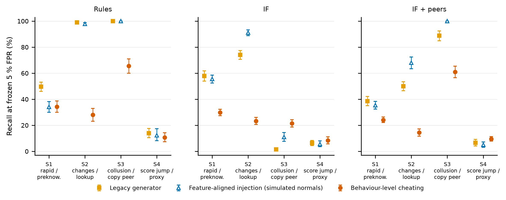
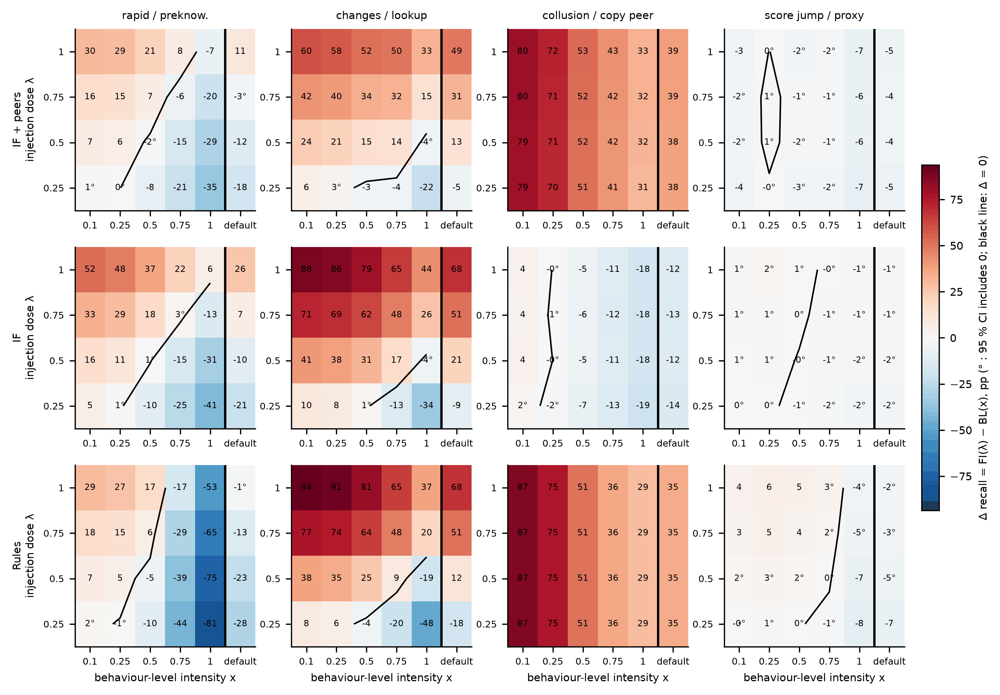
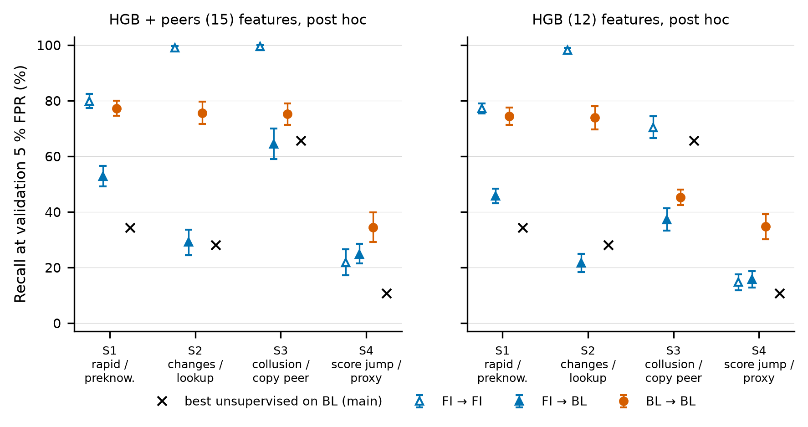

# Feature injection can inflate the performance of quiz-cheating detectors: evidence from behaviour-level simulation

**Status:** revised draft, 15 Nov 2026, after an independent methods review. Numbers are copied from the generated tables in `ml/experiments/inflation/results/tables/`.

**Authors:** Aitbek Kaiyrbekuly¹, Aivar Sakhipov¹
¹ School of Software Engineering, Astana IT University, Astana, Kazakhstan

**Abstract.** Detectors of cheating in online quizzes are rarely evaluated on verified cases. Positive cases are simulated, injected or labelled by heuristics, and the evaluation becomes circular when their definition shares features with the detector. We study one such construction, feature-aligned injection, with a paired simulation. Three detectors frozen in advance (per-feature quantile rules, an Isolation Forest, and the forest with peer features) are evaluated on the same simulated students twice: with anomalies injected along the detectors' own features, and with cheating simulated as behaviour (pre-knowledge, answer look-up, peer copying, proxy test-taking) on top of an item-response and response-time model calibrated on EdNet. At the injection constants of the platform's original generator and the default mechanism assumptions, recall at a 5 % false-positive rate falls from 46–62 % to 23–36 %, and a gradient-boosting classifier trained on injected labels loses 35 percentage points on behaviour-level cheating. The difference is not a constant. It is 54–70 percentage points for look-up and absent or slightly negative for proxy test-taking, and it changes sign when the injected dose is lowered or the behavioural dose raised. The two detectors with peer features detect injected collusion at 99–100 % at every dose because the recipe always satisfies the synchrony condition of those features; behaviour-level pairs who submit separately are detected at 36–40 %. The pattern persists under an exam-like revision rate, a fixed closing time and label-free thresholds, but the rules lose about half of their recall when heavily contaminated training data are not purged of cheaters. On real EdNet logs, detectors without peer features that were fitted on synthetic behaviour flag 11–39 % of attempts at a nominal 5 %. We give recommendations for evaluating log-based cheating detectors and release the simulator and all results.

**Keywords:** academic integrity; online assessment; anomaly detection; cheating detection; synthetic data; evaluation methodology; response times; learning analytics

---

## 1. Introduction

Online quizzes and examinations leave a detailed trace of how a student worked: when each question was shown, how long the first answer took, whether it was later changed, and when the attempt was submitted. Unsupervised and remote assessment makes misconduct easier, and a substantial share of students report having cheated in online exams [@newton2024howcommon]. A growing body of work mines these traces for signs of cheating with statistical rules, anomaly detectors or classifiers [@chandola2009survey; @noorbehbahani2022review; @kaddoura2022review]. Such detectors are attractive for learning management systems because they need no camera, no lockdown browser and no data beyond what the platform already logs.

The weak point of this line of work is evaluation. Verified cases of cheating are rare, confidential, and biased towards what existing procedures already catch. Studies therefore obtain their positive cases in other ways. In a scoping sample of 48 studies from 2015–2026 (Section 2.1, Supplement S3), six evaluated on cheating induced experimentally in real participants and six on cases confirmed or flagged independently of the detector, five of them from one credentialing data set. The others had no labelled positives at all (9), labelled real data with a heuristic or another detector (12), simulated cheating with a psychometric model (12), or altered records by a rule (3).

Several of these constructions share one risk. When the positive cases are defined through quantities that the detector itself measures, or are generated by the model family on which the detector is built, the evaluation partly measures the agreement between the construction and the detector. In test security this has been said plainly: Belov and Toton call validation on simulated aberrance biased, because the same assumptions about the aberrance enter the detector and the simulated data [@belov2022realdata], and Gorney and Wollack show that the choice of generating model changes the measured power of pre-knowledge detectors [@gorney2022generating]. Benchmark studies in outlier detection, intrusion detection and time-series anomaly detection report the same dependence on how anomalies are built [@emmott2013benchmarks; @mchugh2000testing; @wu2023benchmarks].

For log-based detectors in learning platforms the size of this effect has not been examined under controlled conditions. We examine it for the construction in which the circularity is most direct, and which the platform that motivated this study used itself. We call it **feature-aligned injection**: ordinary attempts are perturbed along the detector's features, so that answers become faster, answers are changed more often, two students receive the same answers at the same moment, or the score jumps. Real misconduct is a behaviour with a mechanism, and its footprint in the log is a by-product of that mechanism. The footprint may be weak, may be spread over several features, and may even have the opposite sign to the injected one: looking an answer up makes a student slower, not faster.

We take three detectors that were designed and frozen before the experiment and evaluate the identical code on **paired counterfactual worlds**. The same simulated students, honest attempts and cheaters are rendered once with feature-aligned injection and once with cheating simulated as behaviour. The paired design removes differences in the population. It does not remove the choice of how strongly students cheat, which both constructions must make, so we vary the dose of both. The paper addresses three questions:

1. How much does the measured performance of the same detectors differ between feature-aligned injection and behaviour-level cheating at the constants actually in use?
2. On what does this difference depend: the dose of either construction, the assumed mechanism parameters, the evaluation protocol, and the model of honest behaviour?
3. How do detectors developed on synthetic ordinary behaviour behave on real ordinary logs?

The contributions are an open behaviour-level simulator of quiz attempts with four cheating mechanisms, calibrated on public data and emitting events in the contract of a production platform; the paired comparison with its dose, sensitivity and protocol analyses for unsupervised detectors, a supervised classifier and two classical indices; and false-positive estimates on real logs. All code, parameters, seeds and result files are released.

The detectors studied here produce risk signals for review by a teacher. None of the results should be read as evidence that statistical flags can establish misconduct.

## 2. Related work

### 2.1 Where the positive cases come from

Self-report surveys suggest that cheating in online exams is common [@newton2024howcommon], and comparisons of proctored and unproctored tests point the same way [@alessio2017proctoring; @dendir2020proctoring; @bilen2021online]. Reviews describe a wide range of detection approaches [@noorbehbahani2022review; @kaddoura2022review; @holden2021integrity].

To see how detectors based on log or response data are evaluated, we coded 48 peer-reviewed studies from 2015–2026 by the provenance of their positive cases (Supplement S3; a non-systematic scoping sample by a single coder, so the counts describe the sample and not the literature). The two research traditions differ:

- **Machine learning and learning analytics (23 studies).** Nine have no labelled positives and describe or inspect the flagged cases, as in the work on multiple-account cheating in MOOCs [@northcutt2016cameo; @alexandron2017copying]. Ten label real data with a heuristic rule or with the output of another detector [@ruiperez2019multiple; @alexandron2024general; @tiong2024integrity]. Two inject synthetic cases [@kamalov2021cheating; @shatnawi2025moodle], and two rest on experimentally induced or independently confirmed cheating.
- **Psychometric test security (25 studies).** Twelve simulate cheating with a psychometric model, often the model family of the detector [@sinharay2017statistic; @belov2016preknowledge]. Five use experimentally induced cheating [@ranger2020eexams; @toton2019preknowledge; @diedenhofen2017pagefocus], and five use one credentialing data set with examinees flagged by the testing company [@man2019datamining; @zopluoglu2019xgboost], whose flags came partly from statistical analysis [@belov2022realdata].

In the 15 studies with injected or heuristically labelled positives, the definition of a positive overlaps with the detector's inputs in five, partly in four, not in three, and is unclear in three. All three injection studies overlap: positives are final scores raised above the earlier average for a detector that flags scores above a prediction from those earlier scores [@kamalov2021cheating], injected pairs that share answers for a detector of answer similarity [@shatnawi2025moodle], and response times shifted down on compromised items for a statistic that tests for faster times on those items [@sinharay2020rt]. Some authors avoid the overlap deliberately, for example by removing from the inputs the times that defined the label [@erdem2025cheating]. Feature-aligned injection in the strict sense is thus uncommon in this sample; labels and simulations that share assumptions with the detector are not.

### 2.2 Psychometric indices and field experiments

Educational measurement has a long tradition of indices for specific forms of fraud: person-fit statistics [@drasgow1985appropriateness; @meijer2001personfit; @karabatsos2003personfit]; answer-copying statistics that compare the agreement of two examinees with what is expected [@frary1977indices; @wollack1997copying; @sotaridona2002kindex; @vanderlinden2006copying; @vanderlinden2015checks]; response-time models for aberrant speed and for collusion [@vanderlinden2003aberrant; @vanderlinden2008bayesian; @vanderlinden2009collusion; @marianti2014aberrant]; and methods for item pre-knowledge [@qian2016preknowledge; @sinharay2017preknowledge; @sinharay2020rt; @sinharay2020scores; @belov2016preknowledge; @kasli2023gated; @eckerly2017preknowledge]. The handbook edited by Cizek and Wollack stresses that their power depends on how much of the test is affected and on how the fraud is carried out [@cizek2017handbook].

Two field experiments are the closest external anchors for our simulation. Ranger, Schmidt and Wolgast induced cheating in a 20-item computer-based mock exam [@ranger2020eexams]. Students with pre-knowledge had practised eight of the twenty items; at a false-positive rate of 5 % response-time indicators detected about 60 % and 40 % of them in the two cohorts. In the collusion conditions students received a note during the exam. When the note held the correct answers to all questions, these students revised 6.58 answers on average against 0.84 for regular examinees, and revision indicators detected over 80 % of them. When the note held a peer's partly incorrect answers, revisions averaged 3.93 and none of the indicators detected the condition. A classification tree over twelve of the eighteen indicators reached a sensitivity of 0.42. Toton and Maynes disclosed 12 of 25 items to randomly assigned examinees and used response times to detect them [@toton2019preknowledge]. These experiments show two things that matter below: detection rates on induced cheating are moderate, and students who receive answers during a test do revise many of them.

The same literature supplies the building blocks of our simulator: the hierarchical model of speed and accuracy and the lognormal model of response times [@vanderlinden2006lognormal; @vanderlinden2007hierarchical], rapid guessing by disengaged but honest examinees [@wise2005rte; @wise2017rapid], and the regularities of answer changing [@benjamin1984staying; @vanderlinden2012changes].

### 2.3 Synthetic evaluation data in other fields

How anomalies are constructed is known to drive benchmark conclusions in unsupervised outlier detection [@emmott2013benchmarks; @campos2016evaluation; @goldstein2016comparative; @steinbuss2021benchmarking; @han2022adbench]. The closest precedent is intrusion detection: the DARPA evaluations were criticised for an unvalidated synthetic background [@mchugh2000testing], artefacts of the simulation were found that made attacks detectable for reasons unrelated to the attacks [@mahoney2003darpa], and Sommer and Paxson argued that results obtained in such closed worlds do not transfer to operation [@sommer2010outside]. Similar points have been made for time-series anomaly benchmarks [@wu2023benchmarks], for security research in general [@arp2022dos], for leakage between data construction and modelling [@kapoor2023leakage; @hand2006illusion], and for the base-rate problem that makes even small false-positive rates costly [@axelsson2000baserate].

In learning analytics, synthetic data generators have been proposed as shared references [@berg2016synthetic], and a review of simulated learners found that evidence of validity is often missing and proposed a Turing-like test for simulated data [@kaser2024simulated]. Guidance on simulation studies asks for explicit aims, data-generating mechanisms, estimands and Monte Carlo errors [@morris2019simulation] and warns that design choices made after seeing results can favour any method [@pawel2024pitfalls]. We follow this guidance where we can and mark every analysis that was added after results were seen.

## 3. Materials and methods

### 3.1 Design

The experiment holds the detectors fixed and varies the evaluation data (Table 1).

**Table 1.** Conditions.

| Condition | Ordinary behaviour | How cheating attempts are produced |
|---|---|---|
| LEGACY | ad hoc distributions of the platform's original generator | feature-aligned injection |
| SIM-FI | latent learner model calibrated on EdNet | the same injection recipes |
| SIM-BL | latent learner model calibrated on EdNet | behaviour-level mechanisms |

SIM-FI and SIM-BL are two renderings of the same simulated world: the same students, items, honest attempts, cohorts and set of cheaters. The quantity of interest is the difference in a detector's recall between them at the same false-positive rate. This difference depends on how strongly cheaters cheat under each construction. The primary analysis evaluates it at the constants of the original generator and at default mechanism parameters; further analyses vary both. LEGACY differs from SIM-FI in the ordinary behaviour and in details of the recipes (Supplement S2), so that contrast is descriptive. A fourth data source, real EdNet logs without labels, is used to measure flag rates on ordinary behaviour.

All conditions share the assessment format of the original generator: cohorts of 20 students, a 20-item four-option multiple-choice quiz, three attempts per student on consecutive days on the same form, and cheating only on the final attempt. In the main experiment 12 % of all attempts (36 % of final attempts) are cheating attempts, split 35/25/25/15 % over four types. This prevalence is high; a separate analysis uses 5 % of final attempts. Each replicate has 2,000 students (100 cohorts, 6,000 attempts), and 20 replicates (seeds 1001–1020) are generated per condition unless stated otherwise.

### 3.2 Detectors and protocol

The detectors are those of the Examory platform as tagged at its first project milestone (23 Oct 2026), before the behaviour-level simulator existed. Their code was not modified for this study.

Each attempt is described by twelve attempt-level features computed from answer and submission events: four summaries of first-answer times, the fraction of answers faster than the item's 10th-percentile time among ordinary training attempts, the time taken for the final answer to the last-answered question, the attempt duration, the number and fraction of answer changes, the percentage score, the standardised difference between the score and the student's earlier attempts, and an indicator of missing history. Three peer features are computed against other students of the same cohort and quiz who submitted within ±5 s: the number of such submissions, the maximum fraction of identical final answers, and the same agreement weighted by the rarity of the shared answers. Supplement S2 gives the definitions.

Three detectors are evaluated:

- **Rules:** the score of an attempt is its most extreme two-sided mid-rank over all fifteen features with respect to ordinary training attempts;
- **IF:** an Isolation Forest [@liu2008isolation] with 200 trees on the twelve attempt-level features;
- **IF + peers:** the same forest on all fifteen features. Both forests use scikit-learn [@pedregosa2011sklearn].

Cohorts are split 60/20/20 into training, validation and test sets. References and models are fitted on the ordinary attempts of the training cohorts. The alert threshold is the point of maximum recall on the validation cohorts subject to a false-positive rate (FPR) of at most 5 %, and is then frozen; all metrics are computed on the test cohorts. This protocol contains two oracles, which later analyses remove: the threshold uses validation labels, and the training data are purged of cheating attempts using their labels.

### 3.3 Feature-aligned injection

Four anomaly types are injected on final attempts, each along one family of detector features:

- **rapid response:** each answer is, with probability 0.65, made faster by a factor drawn from U(0.18, 0.55);
- **excessive changes:** each question receives, with a probability drawn from U(0.45, 0.75), one to four answer changes spread over its original first-answer time, so first-answer times also shorten;
- **collusion:** two students of a cohort receive a common answer pattern (30 % of items forced to the same wrong option, the rest copied with probability 0.90), nearly identical response times, and submissions within 1 s of each other;
- **score jump:** the probability of a correct answer is raised by U(0.18, 0.32).

In SIM-FI the same recipes with the same constants are applied to the honest attempts of the simulated students. An injection dose λ multiplies the per-item probabilities and the score shift; λ = 1 is the original recipe. The forced-wrong items and the synchronous submission of the collusion recipe are not scaled.

### 3.4 Behaviour-level simulation

**Honest behaviour.** A student has an ability, a speed correlated with ability, a disengagement propensity and a revision propensity. Items have a discrimination, a difficulty, a common guessing parameter, a time intensity and unequally attractive distractors. With the student's disengagement probability a response is a rapid guess [@wise2005rte]. Otherwise correctness follows the three-parameter logistic model and the response time a lognormal model [@vanderlinden2006lognormal; @vanderlinden2007hierarchical]. After the first answer the student may change it, more often after a wrong answer [@benjamin1984staying; @vanderlinden2012changes]. Navigation is linear.

**Calibration.** All parameters of the honest model are estimated from EdNet-KT2 [@choi2020ednet], the action-level log of a TOEIC tutoring service, restricted to four-option single-question items (Part 5). Users are split by a hash of their identifier into a calibration half and an evaluation half. Supplement S1 gives the estimation procedure, the estimates with confidence intervals and posterior-predictive checks. The model reproduces pooled first-answer times well. It is too dispersed within attempts, too narrow in attempt duration, about one score point too low, and too light in the tail of the change count: simulated attempts contain 4.5 answer changes on average, real ones 6.7.

**Cheating mechanisms.** Cheating is simulated as actions on top of the honest attempt of the same student, re-using the student's latent draws, so that an attempt changes only where the mechanism acts. Mechanism parameters cannot be estimated from data. They are assumed values (Supplement S2) and are varied in the sensitivity analysis.

- **Pre-knowledge** (in the slot of *rapid response*). Each item is leaked with probability 0.65 and a leaked item is recalled with probability 0.92, in which case the answer is correct. Half of the cheaters are *naive* and answer recalled items in a fraction U(0.25, 0.60) of their ordinary time; the others *disguise* their timing.
- **Look-up** (in the slot of *excessive changes*). On an item the student does not know, an external resource is consulted with probability 0.70; this takes a lognormal time (median 35 s) and returns the correct answer with probability 0.90. Half of the cheaters enter their own answer first and correct it afterwards; the others answer only after the look-up.
- **Peer copying** (in the slot of *collusion*). Two students of a cohort form a pair, and the abler one is usually the source. The copier starts shortly after the source and copies each item with probability 0.80, but only after the source has answered it and a relay delay has passed. The source pauses briefly after each copied item. With probability 0.50 the pair submits together, within about 2 s.
- **Proxy test-taker** (in the slot of *score jump*). The final attempt is taken by a different, abler person with their own speed and revision behaviour.

An intensity x replaces the per-item coverage or propensity of the first three mechanisms and scales the ability gain of the proxy.

Two of these mechanisms contain the injected assumption as a sub-case. A naive pre-knowledge cheater is close to the rapid-response recipe with correct answers added, and a pair that submits together satisfies the synchrony that the collusion recipe always imposes. Results for these two slots therefore depend directly on the assumed shares of naive cheaters and of synchronous pairs, and we report both sub-populations separately. Synchronous submission was added after a single-replicate pilot in which 9 of 90 pairs submitted within the 5 s window of the peer features; the amendment makes peer copying easier to detect.

**Implementation.** The simulator is a dependency-free Go program. Every random quantity is drawn from its own stream keyed by the seed and the entity it belongs to, so attempts not touched by cheating are byte-identical across the three logs. Events are written in the platform's event contract and all features are computed by the unchanged production pipeline. A ground-truth file records the mechanism, the role in a pair and the number of affected items.

### 3.5 Real data

The evaluation half of EdNet-KT2 is converted into the same event contract. A pseudo-attempt is a run of 20 consecutive Part-5 questions answered in one sitting. This yields 23,042 attempts of 10,671 users, grouped into 534 pseudo-cohorts of about 20 users. Cohorts are artificial, so peer features carry no meaning on these data. The service is an ungraded self-study tutor; we assume that cheating is negligible there and read the share of flagged attempts as a false-positive rate.

Two protocols are used. In *transfer*, a detector and its threshold are fitted on synthetic ordinary attempts (the original generator, or the honest simulator world with item sets drawn per attempt as in EdNet) and applied unchanged to real attempts. In *refit*, the detector and its threshold are fitted on real cohorts. Because the frozen rules include peer features, a peer-free variant of the rules was built by the evaluation harness for these data. Realism of the synthetic sources is quantified by a classifier two-sample test [@lopezpaz2017c2st]: a gradient-boosting classifier is trained to distinguish real from synthetic ordinary attempts, with cross-validation grouped by user.

### 3.6 Analyses and statistics

**Primary analysis.** The primary outcome is the difference in recall at the frozen 5 % threshold between SIM-FI and SIM-BL, per detector and type, with replicates paired by seed. The plan stored with the code fixed this outcome, the Holm correction over the twelve detector-by-type tests [@holm1979simple], and the decision rule of the platform's hypothesis H1 before the multi-replicate runs; the repository history does not date these steps independently of the results.

**Further analyses.** The following were specified before the calibrated run: transfer of detectors between conditions, behavioural dose–response, low prevalence, the manipulation check, three further unsupervised detectors, and the real-data analysis. The following were added after the main results had been seen, most of them in response to an independent review of the draft, and are exploratory:

- the injection dose λ crossed with the behavioural intensity x (10 replicates);
- a sensitivity analysis over ten mechanism and four injection parameters (60 Latin-hypercube configurations with pairwise rank correlations of at most 0.10, 10 replicates each), which replaced an earlier version with three replicates per configuration;
- protocol variants: a label-free threshold (95th percentile of validation ordinary scores) and fitting on training data from which cheaters were not removed;
- variants of honest behaviour: an exam-like revision rate (0.84 changes per attempt, as reported for regular examinees by Ranger et al.), item sets drawn per attempt, and a fixed closing time at which unfinished attempts are submitted automatically;
- a supervised classifier (gradient boosting with default settings) trained on the labels of one world and tested on both;
- two classical indices under the same protocol: an answer-similarity statistic (standardised number of identical answers of two students, also restricted to incorrect answers) and the response-time person-fit statistic of Marianti et al. [@marianti2014aberrant].

The amendment log in the repository lists every change with its date.

**Statistics.** Values are means over replicates with percentile-bootstrap 95 % intervals over replicates [@efron1993bootstrap]. These intervals quantify Monte Carlo error under fixed code and parameters. They do not express the sampling uncertainty of a single study, in which per-type recall rests on 22–50 cheaters and has a median within-replicate interval of 13–43 pp where recall is not at its ceiling, nor the uncertainty about mechanism parameters. Paired differences are tested with an exact sign-flip permutation test, which replaced the Wilcoxon signed-rank test of the original plan after the review (one Holm-adjusted result in Table 3 depends on this choice: IF + peers on proxy test-taking, p = 0.007 against 0.016); with 20 replicates every non-trivial difference becomes significant, so we emphasise effect sizes. "pp" denotes percentage points and "points" score points out of 20.

## 4. Results

### 4.1 What the manipulations change

Table 2 compares each cheating attempt with the honest attempt of the same simulated student. The injections move one quantity strongly. Excessive changes adds about 27 change events to a 20-item attempt and, because the events are spread over the original answer time, shortens the median first-answer time as much as rapid response does. The behaviour-level mechanisms move several quantities moderately, and not always in the direction the corresponding injection assumes: looking answers up raises the score by 4.5 points, makes the attempt 262 s longer and adds less than one change event. Of the injected score jumps, 2.3 % leave the event stream unchanged and 7.7 % leave the score unchanged; they are counted as positives.

**Table 2.** Manipulation check: mean difference between a cheating attempt and the same student's honest attempt.

| World | Type | Δ score (points) | Δ duration (s) | Δ answer changes | Δ median first-answer time (s) |
|---|---|---:|---:|---:|---:|
| SIM-FI | rapid response | 0.00 | −199.8 | 0.00 | −9.80 |
| SIM-FI | excessive changes | 0.00 | −14.6 | +27.35 | −9.98 |
| SIM-FI | collusion | −3.63 | +18.0 | −4.33 | +0.91 |
| SIM-FI | score jump | +2.91 | 0.0 | 0.00 | 0.00 |
| SIM-BL | pre-knowledge | +4.86 | −92.7 | −2.68 | −4.00 |
| SIM-BL | look-up | +4.46 | +262.4 | +0.61 | +4.50 |
| SIM-BL | peer copying | +0.56 | +64.6 | −1.31 | −1.42 |
| SIM-BL | proxy | +2.91 | −54.5 | −0.89 | −2.14 |

### 4.2 Detector performance at the default constants

The realised FPR on test attempts is 4.2–5.3 % in every condition. Table 3 and Figure 1 give recall.

**Table 3.** Recall (%) at the validation-frozen 5 % FPR threshold, and the paired difference SIM-FI − SIM-BL in pp (20 replicates; exact sign-flip test, Holm-adjusted over the twelve per-type tests).

| Detector | Type (injected ↔ behavioural) | LEGACY | SIM-FI | SIM-BL | Δ [95 % CI] | p (Holm) |
|---|---|---:|---:|---:|---:|---:|
| Rules | all | 68.6 | 61.9 | 36.2 | 25.8 [23.0, 28.6] | |
| Rules | rapid response ↔ pre-knowledge | 49.7 | 34.1 | 34.3 | −0.2 [−6.1, 5.3] | 1.00 |
| Rules | excessive changes ↔ look-up | 99.0 | 97.8 | 28.0 | 69.8 [64.9, 74.6] | < 0.0001 |
| Rules | collusion ↔ peer copying | 100.0 | 100.0 | 65.5 | 34.5 [29.1, 39.9] | < 0.0001 |
| Rules | score jump ↔ proxy | 14.0 | 12.3 | 10.7 | 1.6 [−3.3, 6.9] | 1.00 |
| IF | all | 40.6 | 46.3 | 22.9 | 23.4 [21.0, 25.8] | |
| IF | rapid response ↔ pre-knowledge | 57.9 | 55.6 | 29.8 | 25.7 [23.0, 28.4] | < 0.0001 |
| IF | excessive changes ↔ look-up | 74.1 | 91.1 | 23.2 | 67.9 [64.7, 71.0] | < 0.0001 |
| IF | collusion ↔ peer copying | 1.4 | 11.0 | 21.5 | −10.5 [−14.3, −6.7] | 0.0003 |
| IF | score jump ↔ proxy | 6.3 | 5.6 | 8.3 | −2.7 [−5.5, 0.1] | 0.24 |
| IF + peers | all | 48.6 | 53.6 | 27.8 | 25.8 [23.9, 27.7] | |
| IF + peers | rapid response ↔ pre-knowledge | 38.6 | 35.4 | 24.2 | 11.2 [8.0, 14.7] | < 0.0001 |
| IF + peers | excessive changes ↔ look-up | 50.0 | 68.0 | 14.4 | 53.6 [48.8, 58.3] | < 0.0001 |
| IF + peers | collusion ↔ peer copying | 88.8 | 100.0 | 61.0 | 39.0 [34.6, 43.5] | < 0.0001 |
| IF + peers | score jump ↔ proxy | 6.6 | 5.1 | 9.5 | −4.4 [−6.6, −2.2] | 0.007 |

**Figure 1.** Recall at the validation-frozen 5 % FPR threshold by cheating type, detector and condition (mean over 20 replicates with 95 % interval over replicates).

Over all cheating attempts each detector loses 23–26 pp of recall when injection is replaced by behaviour-level cheating at the default constants. The standardised partial AUC for FPR ≤ 0.05 [@mcclish1989partial] falls from 0.758 to 0.616 for the rules, from 0.656 to 0.555 for IF and from 0.700 to 0.589 for IF + peers. The per-type picture is uneven:

- **Look-up.** All three detectors lose 54–70 pp.
- **Peer copying.** The two detectors that use peer features lose 35 and 39 pp. IF, which has no peer features, detects behaviour-level copying *better* than injected collusion (21.5 % against 11.0 %); the detected attempts are copiers (40.8 %), not sources (2.2 %), and the reversal does not occur with uncalibrated parameters (Supplement S4).
- **Pre-knowledge.** The forests lose 11 and 26 pp; the rules show no difference (−0.2 pp, interval ±6).
- **Proxy.** No detector reaches 15 % recall in any condition. On the simulated students the rules detect it weakly, with a ROC AUC of 0.64 under injection and 0.62 under proxy test-taking, and the forests are close to chance (0.52–0.55). For IF + peers the difference is small and negative.

Relative to the original generator the picture is similar, with one addition: the rules lose 15.4 pp [9.8, 20.8] on pre-knowledge when LEGACY is compared with SIM-BL. The original generator and its port to simulated students thus disagree for this cell, which shows that the result also depends on the ordinary behaviour into which anomalies are injected.

### 4.3 The difference depends on the dose of both constructions

The values in Table 3 hold for one injected dose and one behavioural intensity. Figure 2 crosses four injection doses with five behavioural intensities.

**Figure 2.** Recall difference SIM-FI(λ) − SIM-BL(x) in pp, by detector (rows) and type (columns), for injection dose λ and behavioural intensity x (10 replicates; column "default" is the main configuration; black line: zero difference; ° marks cells whose 95 % interval includes zero).

For pre-knowledge and look-up the difference changes sign inside the grid. At the default behavioural intensity, the rules' difference on look-up is 68 pp at λ = 1, 51 pp at λ = 0.75, 12 pp at λ = 0.5 and −18 pp at λ = 0.25, where the injection touches three items instead of twelve. In the other direction, when every item is leaked (x = 1) the rules detect 86.6 % of behaviour-level cheaters against 33.2 % of injected rapid responders. The absence of a difference for the rules on pre-knowledge in Table 3 is therefore a property of the default coverage of 0.65.

The peer-copying slot behaves differently. Injected collusion is detected by the two peer-aware detectors at 99–100 % at every dose, because the dose scales only the share of copied answers while the six forced-wrong items and the submission within 1 s remain. The difference to behaviour-level copying therefore depends on the behavioural side alone: 87 pp for the rules when one item in ten is copied and 29 pp when all are.

A single injected magnitude can thus be optimistic or pessimistic. What the comparison at default constants shows is that the recipes as they were actually used overstate the detection of look-up and of peer copying by a wide margin.

**Sensitivity to assumed parameters.** Across 60 joint configurations of ten mechanism and four injection parameters (Figure 3), the difference is positive in 98–100 % of configurations for look-up (medians 40–59 pp) and in 92–93 % for peer copying with the peer-aware detectors (medians 40–41 pp). For pre-knowledge it is positive in 42 % of configurations for the rules (median −6 pp), 72 % for IF and 63 % for IF + peers. For IF on peer copying it is negative in every configuration, and for proxy it stays within ±13 pp. Partial rank correlations (exploratory, 336 uncorrected tests) attribute the pre-knowledge difference mainly to the injected per-item probability (0.97–0.98) and the share of naive cheaters (−0.81 to −0.94), the look-up difference to the injected change probability and to the propensity and duration of look-ups, and the peer-copying difference to the share of synchronous pairs (−0.88), the copied share and the injected submission window.

**Figure 3.** Recall difference SIM-FI − SIM-BL across 60 Latin-hypercube configurations of mechanism and injection parameters, by type and detector (one point per configuration, mean of 10 replicates; boxes: quartiles; star: default configuration with 95 % interval; dashed line: 10 pp).

### 4.4 Which cheaters are detected

Table 4 separates the sub-populations that the mechanisms create.

**Table 4.** Recall (%) on behaviour-level cheating by sub-population, at the frozen 5 % threshold. The last two columns are the classical indices of Section 4.6.

| Sub-population | Rules | IF | IF + peers | Answer similarity (incorrect answers) | RT person-fit |
|---|---:|---:|---:|---:|---:|
| Pre-knowledge, naive | 41.0 | 51.7 | 38.6 | | 16.9 |
| Pre-knowledge, disguising | 28.4 | 9.3 | 10.8 | | 2.0 |
| Peer copying, pair submits together | 92.0 | 21.5 | 86.0 | 52.6 | 44.5 |
| Peer copying, pair submits separately | 39.8 | 22.1 | 36.1 | 47.9 | 43.2 |
| Peer copying, copier | 69.3 | 40.8 | 71.3 | | |
| Peer copying, source | 61.7 | 2.2 | 50.7 | | |
| Injected collusion (SIM-FI), for reference | 100.0 | 11.0 | 100.0 | 99.9 | 6.2 |

Pairs that submit together are detected by the peer-aware detectors almost as reliably as injected collusion; pairs that do not are detected at 36–40 %. For these detectors, performance on "collusion" measures mostly whether colluding students submit within the 5 s window that the peer features require, a condition the injection always satisfies. The forests detect disguising pre-knowledge cheaters at about 10 %, the rules at 28 %. Sources of copied answers are invisible to attempt-level features.

### 4.5 Robustness to the protocol and to the model of honest behaviour

Table 5 repeats the main comparison under variants of the protocol and of honest behaviour.

**Table 5.** Recall difference SIM-FI − SIM-BL over all cheating attempts, in pp [95 % CI], under variants of the evaluation (20 replicates each).

| Variant | Rules | IF | IF + peers |
|---|---:|---:|---:|
| Main protocol | 25.8 [23.0, 28.6] | 23.4 [21.0, 25.8] | 25.8 [23.9, 27.7] |
| Label-free threshold | 24.6 [21.9, 27.4] | 22.9 [20.6, 25.1] | 25.7 [23.8, 27.6] |
| Training data not purged of cheaters | 5.5 [2.9, 8.2] | 20.5 [18.7, 22.3] | 22.8 [20.6, 25.0] |
| Exam-like revision rate | 20.8 [17.6, 24.1] | 20.4 [18.0, 22.8] | 26.3 [23.4, 28.9] |
| Item sets drawn per attempt | 35.9 [32.8, 38.8] | 23.3 [20.7, 26.0] | 28.1 [26.2, 30.2] |
| Closing time, 5 % of ordinary attempts cut off | 23.8 [21.0, 26.7] | 22.9 [20.4, 25.5] | 24.8 [22.4, 27.2] |
| Closing time, 16 % of ordinary attempts cut off | 25.8 [23.4, 28.2] | 23.4 [21.0, 25.9] | 24.1 [22.2, 26.1] |

A threshold set without labels changes nothing of substance. The variants of honest behaviour change individual cells but not the pattern. With an exam-like revision rate, behaviour-level look-up becomes easier to detect (rules 44.1 % instead of 28.0 %, IF 46.9 % instead of 23.2 %) because the few changes it adds stand out against a quiet baseline; the difference to the injection remains 52–59 pp. With the earlier of the two closing times, which cuts off 16 % of ordinary attempts, 32 % of ordinary attempts have a synchronous peer instead of 17 %, and IF + peers detects synchronous pairs less often (64.0 % instead of 86.0 %), while the rules are less affected (84.7 % instead of 92.0 %).

Purging matters far more. When the cheaters of the training cohorts stay in the data from which references and models are fitted, the forests lose 4–10 pp, but the rules collapse in both worlds: from 61.9 % to 26.1 % under injection and from 36.2 % to 20.6 % under behaviour-level cheating. Injected anomalies are extreme and homogeneous, so they move the reference quantiles on which the rules depend, and most of the rules' advantage under injection disappears. This is a consequence of heavy contamination: in the main experiment 12 % of the training attempts are cheating attempts. At the low prevalence of Section 4.7 (1.6 %), fitting without purging changes the rules' recall little (55.0 % to 55.2 % under injection, 32.3 % to 28.5 % under behaviour-level cheating) and leaves the difference between the worlds as large as before (26.7 pp).

**Hypothesis H1.** The platform's verification plan stated that IF + peers should exceed the rules in recall by at least 15 pp on collusion-type and score-jump-type cheating, and that the rules would be adopted if the gain was below 5 pp. Under the main protocol the gain on behaviour-level data is −4.5 pp [−7.4, −1.2] on peer copying and −1.2 pp [−3.8, 1.4] on proxy test-taking, so H1 is not supported. The verdict depends on purging at the high prevalence of the main experiment. Without purging, when 12 % of the training attempts are cheating attempts, IF + peers detects 57.8 % of peer copying and the rules 36.4 %, a gain of 21.4 pp [15.6, 26.6] that would meet the criterion for that type (2.1 pp on proxy). At the low prevalence, when 1.6 % of the training attempts are cheating attempts, the rules stay ahead with purging (gain −16.6 pp [−25.9, −7.6] on peer copying) and without it (−5.2 pp [−14.5, 4.6]); on peer copying the rules go from 82.5 % to 73.3 % and IF + peers from 65.9 % to 68.1 %. The rules are adopted for the platform on this basis, with the test on real logs still pending.

### 4.6 Supervised and classical detectors

**Supervised classifier.** A gradient-boosting classifier on the same fifteen features answers two questions that unsupervised detectors cannot (Table 6, Figure 4). First, a classifier trained and thresholded on injected labels loses 34.8 pp [32.6, 36.9] of recall when it meets behaviour-level cheating, 69.9 pp on look-up. The inflation is therefore not specific to unsupervised detection. Second, when the classifier is trained on behaviour-level labels it detects 69.6 % of behaviour-level cheating, 33.5 pp [30.8, 36.2] more than the best of the three frozen detectors, and 75–77 % of pre-knowledge, look-up and peer copying. The features do carry the signal of these mechanisms; the unsupervised detectors do not find it, and a classifier trained on injected labels finds less than half of it for look-up (29.1 % against 75.6 %). The transfer fails in the other direction as well.

**Table 6.** Recall (%) of a gradient-boosting classifier at the 5 % FPR threshold of its training world (20 replicates; realised FPR 5.3–5.6 %).

| Trained on → tested on | All | Pre-knowledge slot | Look-up slot | Peer-copying slot | Proxy slot |
|---|---:|---:|---:|---:|---:|
| Injection → injection | 79.8 | 79.9 | 99.0 | 99.4 | 21.9 |
| Injection → behaviour | 45.1 | 52.8 | 29.1 | 64.4 | 24.8 |
| Behaviour → injection | 48.7 | 33.9 | 27.5 | 100.0 | 41.7 |
| Behaviour → behaviour | 69.6 | 77.2 | 75.6 | 75.2 | 34.5 |

**Figure 4.** Recall of the supervised classifier by training world, test world and cheating type (mean over 20 replicates with 95 % interval).

**Classical indices.** The answer-similarity statistic restricted to incorrect answers detects 99.9 % of injected collusion and 50.4 % of behaviour-level copying, almost equally for pairs that submit together and separately (Table 4). It is thus as inflated by the injection as the peer features are, but it does not depend on synchrony and exceeds IF + peers on pairs that submit separately. The response-time person-fit statistic detects 38.6 % of injected rapid responders and 9.4 % of behaviour-level pre-knowledge, and 55.6 % against 15.8 % in the look-up slot. It also detects 44.0 % of behaviour-level copying against 6.2 % of injected collusion; copiers wait for the source and then answer quickly, which is the kind of irregular timing the statistic measures.

**Other unsupervised detectors.** The local outlier factor [@breunig2000lof] and a one-class support vector machine [@scholkopf2001support] reproduce the pattern of Table 3 for look-up (53–56 pp), peer copying (27–29 pp with peer features) and proxy (Supplement S4). With peer features they detect more behaviour-level cheating overall than any of the frozen detectors (40.9 % and 44.4 % against 36.2 % for the rules, at a realised FPR of 5.1–5.3 %). A third detector of this stage, a minimum-covariance-determinant detector, detects 25.0 %.

### 4.7 Precision at a low prevalence

With cheating on 5 % of final attempts (1.7 % of all attempts) there are about four alerts per 100 attempts (Table 7). Under behaviour-level cheating the precision of the rules is 15.0 %, less than half of what the original generator suggests. For IF + peers there is no such inflation: its precision is 17–20 % in all three conditions, because under behaviour-level cheating it raises fewer alerts. Among final attempts only, where all cheating occurs, 32 % of the rules' alerts and 40 % of the alerts of IF + peers concern cheaters. The recall differences between the two worlds are as large at this prevalence as in Table 3 (23–25 pp over all cheating attempts).

**Table 7.** Precision (%) at the frozen 5 % threshold when 5 % of final attempts are cheating attempts (20 replicates).

| Detector | LEGACY | SIM-FI | SIM-BL |
|---|---:|---:|---:|
| Rules | 34.0 [26.3, 42.6] | 27.4 [22.6, 32.8] | 15.0 [11.7, 19.0] |
| IF | 17.5 [14.5, 20.6] | 15.3 [13.6, 17.1] | 6.6 [5.0, 8.5] |
| IF + peers | 18.1 [15.5, 20.6] | 19.7 [15.1, 25.0] | 17.4 [10.6, 26.5] |

### 4.8 Real data

A classifier separates real EdNet attempts from attempts of the original generator and of the uncalibrated simulator almost perfectly (AUC 0.999 and 1.000). After calibration the AUC is 0.830 on the ten timing, change and score features and 0.947 on all twelve attempt-level features, which include the history features. Calibrated attempts are closer to real ones but remain clearly distinguishable.

Table 8 gives the share of real attempts flagged at a nominal 5 % by detectors without peer features. A detector fitted on a generator whose ordinary behaviour was never matched to the target platform flags a third of real attempts. This is covariate shift, and the more informative figure is the one after calibration: 11 % for IF and 22 % for the rules, two to four times the nominal rate. Replicates differ in the synthetic training data, and single replicates deviate from these means by several pp: for the rules fitted on the calibrated simulator the ten replicates range from 18.3 % to 27.9 %. The frozen IF + peers fitted on the calibrated simulator flags 5.3 %, but peer features are not meaningful on these data.

**Table 8.** Share of real EdNet attempts flagged at a nominal 5 % FPR (detectors without peer features; mean over 10 replicates with 95 % interval of the mean).

| Detector fitted on | IF | Rules (attempt-level features) |
|---|---:|---:|
| Real attempts (refit) | 4.9 [4.6, 5.2] | 5.2 [4.8, 5.5] |
| Original generator | 31.5 [29.7, 33.6] | 39.1 [37.6, 40.6] |
| Simulator, default parameters | 30.4 [28.5, 32.3] | 36.8 [35.1, 38.4] |
| Simulator, calibrated | 11.4 [10.6, 12.2] | 22.0 [20.7, 23.6] |

When IF is refitted on real attempts it flags 4.9 % of them, unevenly: 12.6 % of attempts in the fastest quartile of median answer time against 0.5–0.6 % in the two middle quartiles, and 6.8 % in both the lowest and the highest score stratum against about 3 % in between. This follows from how a two-sided outlier detector on timing and score features works, and the strata are defined on detector inputs, so it is a description of who bears the false alerts and not an independent finding.

## 5. Discussion

**What the comparison shows.** At the constants that the platform's generator actually used, the same detectors on the same simulated students lose 23–26 pp of recall, between 42 % and 51 % of it, when feature-aligned injection is replaced by behaviour-level cheating. The loss is concentrated in look-up and in peer copying. It is not a universal constant. The dose analysis shows that the difference can be made to take either sign by weakening the injection or strengthening the behaviour, and the sensitivity analysis shows that for pre-knowledge even the sign at plausible settings is open. The supportable claim is therefore that recall measured on feature-aligned injection does not predict recall on behaviour-level cheating, and that for the recipes examined here the error was large and optimistic for two of four types.

**Three properties of the recipes explain the result.**

- *Magnitude.* An injection is free to choose an effect size that no simulated behaviour produces, such as 27 extra answer changes together with shorter first-answer times.
- *Direction.* The recipe encodes an assumption about what cheating looks like. Looking an answer up makes simulated students slower and more accurate, not faster (Table 2).
- *Co-design.* The collusion recipe always satisfies the condition under which the peer features are evaluated, at every dose, so the evaluation reflects that condition instead of testing it (Table 4, Figure 2).

Magnitude can be varied; direction and co-design cannot be repaired by tuning the dose.

**The signal is present, and the choice of construction decides who finds it.** A supervised classifier trained on behaviour-level labels recovers most of the look-up, pre-knowledge and peer-copying cases from the same fifteen features. The low recall of the unsupervised detectors on behaviour-level cheating is therefore not a ceiling. It also means that a classifier trained on injected labels, which is the natural next step for a team that has built an injection generator, would learn the recipe: it reaches 99 % on injected look-up and 29 % on the behavioural one.

**Comparison with field experiments.** Ranger et al. detected about 40–60 % of students who had practised 8 of 20 items, at a 5 % false-positive rate [@ranger2020eexams]. At a comparable coverage (x = 0.5) our detectors reach 15–18 %, and 24–34 % at the default coverage of 0.65, so the simulated pre-knowledge is, if anything, harder to detect than the induced one. Their strong collusion condition cuts the other way for our look-up mechanism. Students who received all correct answers during the exam revised 6.6 answers against 0.8, and revision indicators detected over 80 % of them. Our simulated look-up adds less than one change, because half of the simulated cheaters consult the resource before answering. Real students who obtain answers after having answered behave more like the injected "excessive changes" than our default mechanism does, although the injection adds 27 changes, four times the observed number. The look-up difference at default settings should be read with this in mind; a mechanism in which answers arrive late and are corrected in bulk was not simulated.

**Consequences for practice.**

- Operating thresholds must be set on real ordinary behaviour of the target population. Detectors developed on synthetic behaviour flagged 11–39 % of real attempts at a nominal 5 %.
- Whether training data are purged of cheaters must be reported. With 12 % of cheating attempts in the training data, the reference-based rules lost about half of their recall without purging and the forests 4–10 pp, which reversed their ordering under injection; with 1.6 % the ordering did not change.
- At a low prevalence most alerts are false, and they fall on the fastest students and on both ends of the score distribution; unequal error rates across groups of students are a known concern for educational algorithms [@baker2022bias]. A flag of this kind can prioritise a teacher's attention; it cannot support an accusation.

**Recommendations for evaluating log-based cheating detectors.**

1. Do not define positive cases through the detector's own features or model family, whether by injection or by a labelling heuristic. If this is unavoidable, report the effect of the construction on every feature (Table 2) and state the overlap.
2. Simulate cheating as behaviour with explicit mechanisms, vary the dose and the assumed parameters, and report the range of results. Report sub-populations that a detector's features single out, such as pairs that submit together.
3. Hold the honest population fixed when comparing constructions, and check conclusions against at least one alternative model of honest behaviour.
4. Freeze the detector and the threshold rule before generating evaluation data, set thresholds without labels, and evaluate with and without purging of the training data.
5. Calibrate ordinary behaviour on real logs, quantify the remaining gap, and estimate false-positive rates on real ordinary behaviour. Label synthetic results as synthetic.

## 6. Limitations

**Simulation.** Both constructions compared here are synthetic, and so is every detection result. The honest model is calibrated on real logs, but the cheating mechanisms rest on assumed parameters; the sensitivity analysis shows how the conclusions move over wide ranges of fourteen of them, not that the mechanisms are correct. Four mechanisms do not exhaust how students cheat, combinations were not simulated, and the pairing of each mechanism with an injected type is a judgement. Synchronous submission was added to peer copying after a pilot.

**Injection recipes.** The recipes are those of one platform's generator. The scoping sample suggests that strict feature-aligned injection is uncommon in published work, and we did not re-implement a published recipe. The results show what happened with these recipes, and why; they do not estimate how large the problem is in the literature.

**Honest behaviour.** The calibration data come from an ungraded self-study tutor with adaptive item selection, not from course examinations. The fitted model has known misfits (Section 3.4), the guessing parameter comes from a fit that had not converged, and the practice gain is weakly identified. Students in the simulation do not remember items across the three attempts on the same form. The closing-time variant does not model students who speed up before a deadline. A classifier still separates calibrated simulated attempts from real ones. EdNet has no cheating labels, so the real-data analysis concerns false positives only, under the assumption that cheating in an ungraded tutor is negligible.

**Protocol.** The study uses one assessment format and one family of features. The prevalence in the main experiment is high. Analyses added after the main results were seen are exploratory, and their number is large enough that individual small effects should not be over-read; the conclusions rest on effects of tens of percentage points. All replicates share code and parameter files and do not cover model uncertainty.

**External validation.** No labelled real data were used. The experimental pre-knowledge data of Toton and Maynes [@toton2019preknowledge] would provide a labelled anchor for one mechanism; we found no openly licensed copy.

## 7. Conclusions

When the anomalies used to evaluate a cheating detector are defined along the detector's own features, the evaluation says little about behaviour that was not built that way. With detectors, students and cheaters held fixed, replacing the injection recipes of one platform by behaviour-level cheating removed about a quarter of recall in absolute terms at a 5 % false-positive rate. Most of the loss came from look-up and peer copying, there was none for proxy test-taking, and the sign depended on dose for pre-knowledge. The same happened to a supervised classifier trained on injected labels, although the features carried enough signal for a classifier trained on behaviour-level labels to find most cases. Detectors developed on synthetic ordinary behaviour over-flagged real attempts two- to eightfold when they had no peer features. Synthetic evaluation remains useful when cheating is modelled as behaviour, its assumptions are varied, and its results are presented as what they are. Verified cases from consented pilots remain the only basis for claims about detecting actual misconduct.

---

## Supplementary material and availability

- **Code and results:** https://github.com/Newterios/Examory. The repository contains the simulator (`sim/`), the EdNet conversion and calibration (`ml/ednet/`), the experiment harness with per-replicate results, tables and figures (`ml/experiments/inflation/`), and the frozen detector pipeline (`ml/anomaly/`).
- **Supplement S1** (calibration: procedure, estimates with confidence intervals, fit diagnostics): `ml/ednet/calibration_report.md`.
- **Supplement S2** (features, injection recipes, mechanism parameters and the ranges of the sensitivity analysis): `docs/11_paper/supplement/S2_methods_details.md`; full definitions in `sim/README.md`.
- **Supplement S3** (scoping sample of 48 studies): `docs/11_paper/supplement/S3_scoping_survey.md`.
- **Supplement S4** (all result tables: metrics at 1 % FPR, partial AUC, transfer between conditions, dose grids, sensitivity, protocol and baseline variants, supervised and classical detectors, additional unsupervised detectors, prevalence, hypothesis H1, strata on real data, results with uncalibrated parameters): `ml/experiments/inflation/results/tables/` and `ml/experiments/inflation/results_defaults/`; the analysis plan and amendment log are in `ml/experiments/inflation/README.md`.
- **Data:** EdNet is available from its maintainers (https://github.com/riiid/ednet) under CC BY-NC 4.0 and is not redistributed here. Scripts record the SHA-256 of the archives used.

## Declarations

Author contributions, funding, conflicts of interest and the statement on the use of generative AI tools are to be completed by the corresponding author according to the policy of the target journal.

## References

The reference list is generated from `references.bib` (citation keys in square brackets above) in the style of the target journal.
